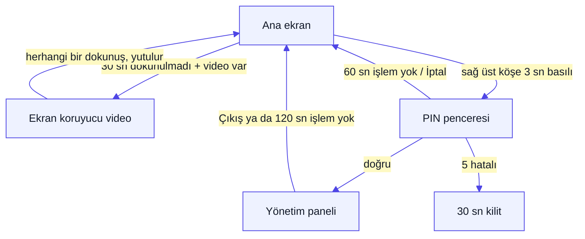

# Yönetim Paneli ve Ekran Koruyucu

⬅ [Genel Mimari (Hub)](hub.md)

Kiosk sahadayken ayarların ekrandan, kullanıcıya görünmeden değiştirilebilmesi için eklendi. Faz 1 (2026-11-18) cihazda çalıştı: COP31 videosu ekran koruyucu olarak seçildi (2026-11-23). Faz 2'nin ilk iki adımı 2026-11-23'te yazıldı, cihazda denenmesi bekleniyor.

## Verilen kararlar (2026-11-18)

- Ekran koruyucu **yalnızca ana ekranda** açılır; tur, ölçüm, sonuç ve admin ekranlarında açılmaz.
- **Tek video**, döngüde, **sessiz**. Oynatma listesi gerekirse sonra.
- Varsayılan PIN **888888**. Şifre sayfasından değiştirilince salt'lı PBKDF2 özeti olarak saklanır.
- Referanstaki ikinci "Log out" şifresi şimdilik **yok**.

## Akış

## Nasıl çalışıyor

| Parça | Dosya | Not |
|---|---|---|
| Dokunuş takibi | `MainActivity.dispatchTouchEvent` | Her dokunuş `onUserActivity()` çağırır. Ekran koruyucu açıkken ilk dokunuş hareketi yutulur, alttaki butona geçmez. |
| Boşta izleyici | `KioskViewModel.startIdleWatcher` | Saniyede bir kontrol. Video yoksa ya da dosya silinmişse ekran koruyucu açılmaz. `goHome()` sayacı sıfırlar. |
| Oynatıcı | `ui/screens/ScreensaverFrame.kt` | Media3 ExoPlayer 1.4.1 + `PlayerView`, `REPEAT_MODE_ALL`, `volume = 0`, `RESIZE_MODE_FIT`. |
| Gizli giriş | `AdminHotCorner` (`AdminPinDialog.kt`) | Sağ üstte görünmez 140 ds alan; Compose'un 400 ms uzun basması yerine 3 sn. |
| PIN penceresi | `AdminPinDialog` | Kendi tuş takımı (cihaz klavyesine bağımlı değil). 5 hatada 30 sn kilit. |
| Admin ekranı | `ui/screens/AdminFrame.kt` | Sol menü: Ekran Koruyucu, Ölçüm Modülleri, Şifre, Donanım Portları. Süre, aç-kapa ve modüller "Kaydet" ile; video ve PIN anında uygulanır. |
| Oturum zaman aşımı | `KioskViewModel.startIdleWatcher`, `AppSettings.sessionTimeoutSeconds/prepTimeoutSeconds` | Hazırlık/uyarı/sonuç 60 sn, cihaz hazırlık 120 sn dokunulmazsa ana ekran (15–600 sn, Süreler sekmesi). Measuring'de çalışmaz. |
| Geri sayım | `ui/frames/CountdownBadge.kt`, `KioskViewModel.updateCountdown` | Sol altta. Hazırlık/uyarı/sonuç/cihaz hazırlık: "Ana ekrana dönüş" (dokununca başa döner). Ölçüm: "Kalan ölçüm süresi" = modülün üst sınırı (boy 15, ateş 30, SpO2 75, tansiyon 120 sn; dokunmak uzatmaz). Son 10 sn kırmızı. |
| Sistem Bilgisi | `ui/screens/SystemInfo.kt` | Sürüm, Android, cihaz, çip, RAM, depolama, ekran, IP, Android ID. |
| Modül aç/kapa | `AppSettings.enabledModules`, `KioskViewModel.tourModules()` | Kapalı modül turda sorulmaz, hazırlık listesinde görünmez. Son açık modül kapatılamaz. |
| Donanım portları | `HardwarePortsFrame` | Ana ekrandaki "Portlar" düğmesi kaldırıldı; yalnız admin'den açılır, Geri admin'e döner, 120 sn işlem yoksa ana ekrana döner (tarama sürerken değil). |
| Ayar deposu | `application/port/AppSettings.kt` → `adapter/settings/SharedPrefsAppSettings.kt` | `kiosk_settings` prefs: açık/kapalı, süre (10–600 sn), video yolu, PIN salt+hash. |
| Video içe aktarma | `ScreensaverVideoImporter` → `FilesDirScreensaverVideoImporter` | Android dosya seçicisi (`OpenDocument`, `video/*`), kopya `filesDir/screensaver/`. USB çıkarılsa da çalışır. |
| PIN | `domain/AdminPin.kt` | PBKDF2WithHmacSHA1 (minSdk 24), 10 000 tur, 16 bayt salt. Test: `AdminPinTest`. |

## Bilinen riskler / denenecekler

- RK3576 kutusunda Android dosya seçicisi (DocumentsUI) olmayabilir. Yoksa uygulama içi USB/SD dosya gezgini gerekir.
- Video formatı: MP4 (H.264), dikey 1080×1920 önerilir. Yatay video `FIT` ile siyah bantlı görünür.
- Ekran klavyesi yalnız Şifre sayfasındaki alanlarda kullanılır. PIN girişinde kendi tuş takımımız var.
- Lztek kiosk modu açıkken sistem dosya seçicisinin açılıp açılmadığı kontrol edilmeli.

## Referans kiosk (15 fotoğraf) ve yol haritası

Referans: innova markalı başka bir sağlık kabini; mavi sol menü + sağ üstte Kaydet/Çıkış.

| Referans menü | Bizde | Faz |
|---|---|---|
| Ad Settings (logo, firma adı, görsel reklam listesi) | Ekran Koruyucu (tek video) | 1 ✔ |
| Password (Login / Log out) | Şifre (tek PIN) | 1 ✔ |
| Serial Port (rol başına port seçimi) | `HardwarePortsFrame` admin'e taşındı (rol başına elle seçim yok) | 2 ✔ |
| Functions Settings (modül anahtarları) | Ölçüm Modülleri sekmesi | 2 ✔ |
| Voice & Time (modül başına hazırlık süresi, sonuç gösterim süresi, ses) | Süreler sekmesi (oturum + hazırlık zaman aşımı; modül başına süre ve ses yok) | 2 ✔ |
| System (IP, sürüm, Android ID, sistem ayarları) | Sistem Bilgisi sekmesi (salt okunur) | 2 ✔ |
| Data Query / Data Upload | Yerel kayıt (Room) + [Veri Yükleme](veri-yukleme-arayuzleri.md) kararı gerekir | 3 |
| Calibration (boy/kilo) | Sensör komutları gerekir ([DYP-H01](dyp-h01-boy.md)) | 3 |
| Printer Settings | [Faz 2 yazıcı](faz2-yazici-vucut-analizi-yukleme.md) | 3 |
| Coin, Bluetooth, Face Information, Language, Basic (aktivasyon modu) | Karşılığı yok | — |

## İlgili

- [Kiosk UI Akışı](kiosk-ui-akisi.md) — `KioskScreen.AdminHome` yeni ekran olarak eklendi.
- [Hexagonal Mimari](hexagonal-mimari.md) — iki yeni port: `AppSettings`, `ScreensaverVideoImporter`.
