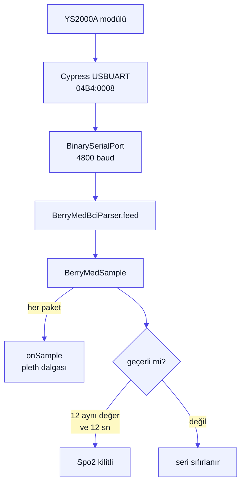

# BerryMed YS2000A SpO2 Modülü

⬅ [Genel Mimari (Hub)](hub.md)

Modül, komut beklemeden sürekli **BCI** akışı yayınlar; uygulama yalnız dinler. Tur sırasında üçüncü adımdır.

## Bağlantı

| Özellik | Değer |
|---------|-------|
| USB | Cypress USBUART `04B4:0008`, Linux'ta `cdc_acm` → `ttyACM0` |
| Önyükleyici | Takılırken `04B4:B71D` (PSoC5LP Bootloader, HID) görünür, ~1 sn sonra `0008`'e yeniden numaralanır (`etc/spo2/android-log.txt`) |
| Seri | 4800 baud, 8N1; uygulama rolü `SPO2_BERRYMED` |

## Paket yapısı (5 bayt)

Senkron kuralı: ilk baytın 7. biti **1**, sonraki dört baytın 7. biti **0**; aksi halde ilk bayt atılır.

| Bayt | Alanlar |
|------|---------|
| `b0` | alt 4 bit sinyal gücü; bit4 sinyal yok; bit5 prob çıkarılmış; bit6 nabız bip |
| `b1` | alt 7 bit pleth (0–127) |
| `b2` | alt 4 bit bargraph; bit4 sensör kapalı; bit5 nabız aranıyor; bit6 nabız yüksek biti |
| `b3` | alt 7 bit nabız düşük bitleri |
| `b4` | alt 7 bit SpO2 |

`nabız = (b2.bit6 << 7) | b3`; SpO2 yalnız `1..100` ve `0x7F` değilse, nabız yalnız `1..254` ise geçerlidir. `isFingerPresent = !probeUnplugged && !sensorOff && !noSignal`; `hasValidVitals = isFingerPresent && spo2 != null && nabız != null`.

## Adaptör (`BerryMedSpo2Adapter`)

- Her pakette `onSample(spo2, nabız, pleth)` çağrılır (canlı grafik/değer).
- Geçerli örneklerde **art arda 12 aynı SpO2 değeri** (`stableCount`) kilit adayı olur; kilit en az **12 sn** (`minDurationMs`, grafiğin görünmesi için) geçtikten sonra verilir.
- Geçersiz örnek (parmak yok vb.) seriyi ve adayı sıfırlar.
- 75 sn dolarsa eldeki aday döner; aday yoksa `"BerryMed kararlı SpO2 alınamadı"` hatası.
- Sonuç `Spo2(percent, locked = true)`; nabız ekranda canlı gösterilir ama sonuca yazılmaz.

Ekranda kilit anında değer 2,5 sn tutulur ([Kiosk UI Akışı](kiosk-ui-akisi.md)).

## Mock ve test

`MockBerryMedSpo2Adapter` ~12 sn sinüs pleth üretir, SpO2'yi 95 → 97 → 98 rampalar ve %98'de kilitler. Keşif mock'u sabit `80 40 00 48 62` paketi döndürür (SpO2 98, nabız 72). `EtcProtocolParserTest.berryMedParsesFiveBytePacket` paket çözümünü doğrular.

## Kaynaklar

`etc/spo2/YS2000A SpO2&Temp Module/` altında işletim kılavuzu (`…ModuleV1.3.pdf`), demo kaynağı (`SPO2-demo.rar`), demo `SPO2.exe` ve `CypressDriverInstaller.exe`; `etc/spo2/python/berrymed-ys2000a.pyw` PyQt6 test aracıdır. Modül adı SpO2 **ve sıcaklık** modülüdür; uygulama yalnızca SpO2/nabız/pleth kullanır. PDF kılavuz bu sayfa için okunmadı; bilgiler koddan alınmıştır.

## İlgili

- [Donanım Keşfi ve USB](donanim-kesfi-ve-usb.md)
- [DYP-H01 Boy](dyp-h01-boy.md) · [Raycome Tansiyon](raycome-rbp7000-tansiyon.md)
