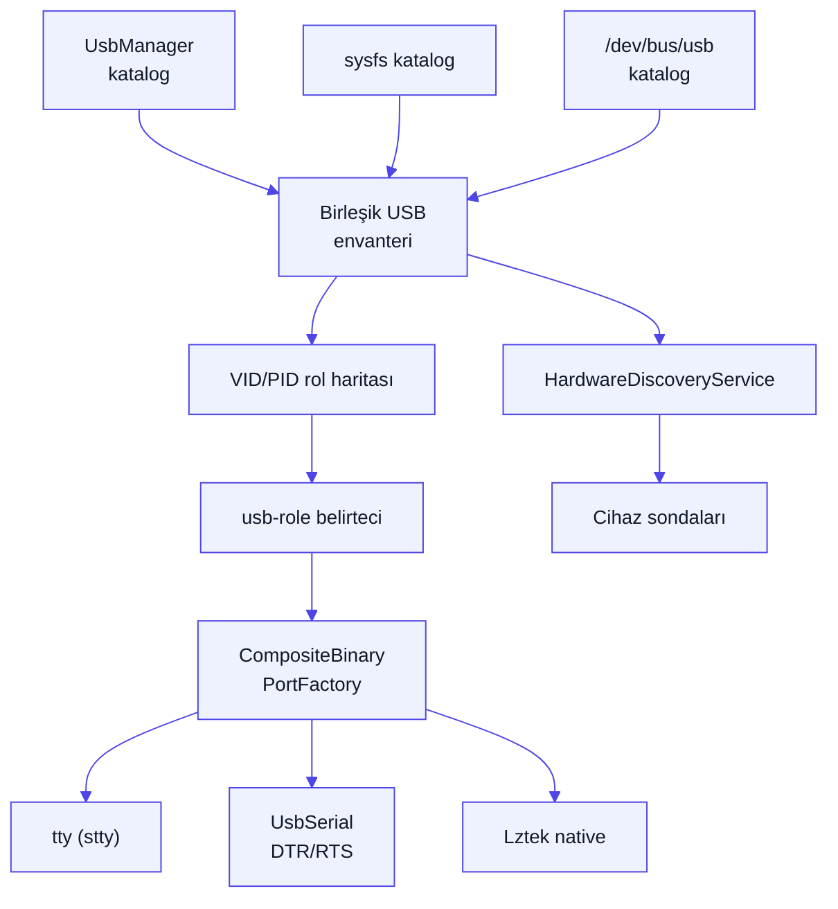

# Donanım Keşfi, USB Envanteri ve Port Çözümleme

⬅ [Genel Mimari (Hub)](hub.md)

Anakartta hangi cihazın hangi porta bağlı olduğu belgelenmediği için ([Fizibilite Raporu](fizibilite-raporu.md)) uygulama portları **USB kimliğinden (VID/PID)** ve gerektiğinde **protokol el sıkışmasından** keşfeder.

## USB envanteri (üç kaynak)

| Katalog | Kaynak | Neden gerekli |
|---------|--------|---------------|
| `AndroidUsbDeviceCatalog` | `UsbManager.deviceList` (izin durumu `hasPermission`) | Standart Android USB Host |
| `SysfsUsbDeviceCatalog` | `/sys/bus/usb/devices` (hub sınıfı `09` ve arayüz düğümleri atlanır) | Rockchip'te kernel `hid-generic` HID'i sahiplenir; HeTaiDa `UsbManager` listesinde görünmez, sysfs'te VID/PID vardır |
| `FilesystemUsbBusCatalog` | `/dev/bus/usb/<bus>/<dev>` | `UsbManager` göstermese de yol görünsün (VID/PID yok) |

`MergingUsbDeviceCatalog` aynı `deviceName` için VID/PID'li kaydı tercih eder; sonuç, kimliği bilinenler önce olacak şekilde sıralanır. Gerçek liste boşsa ve ortam "mock donanım" ise `FallbackUsbDeviceCatalog` dört örnek cihazlı `MockUsbDeviceCatalog`'a düşer.

## VID/PID → rol (`UsbSensorRoleMap`)

| VID:PID | Kimlik | Rol | Modül |
|---------|--------|-----|-------|
| `0C45:7702` | HeTaiDa HTD8808C (SONiX HID) | `TEMPERATURE_HETAIDA` | Ateş |
| `1A86:7523` | CH340 USB Serial | `HEIGHT_DYP` | Boy |
| `04B4:0008` | Cypress USBUART | `SPO2_BERRYMED` | SpO2 |
| `0403:6001` | FTDI FT232R | `BLOOD_PRESSURE_RAYCOME` | Tansiyon |
| `04B4:B71D` | Cypress Bootloader | — (rol yok) | — |

Roller yol belirteci olarak taşınır: `usb-role:<ROL>` (ör. `usb-role:HEIGHT_DYP`). `AttachedEtcSensors.presentModules` envanterden takılı modülleri çıkarır.

> Dikkat: eşleme çip bazlıdır. Aynı çipi kullanan ikinci bir cihaz (ör. başka bir CH340 adaptör) aynı role düşer. Cypress cihazı önce `04B4:B71D` (PSoC5LP Bootloader, HID) olarak görünüp ~1 sn sonra `04B4:0008` USBUART olarak yeniden numaralanır; `etc/spo2/android-log.txt` bunu gösterir.

## Seri port adayları

- `FilesystemSerialPortCatalog`: `/dev` altındaki `ttyUSB*`, `ttyACM*`, `ttyXRUSB*`, `ttyS*`, `ttyMT*` düğümleri; sıralama USB-seri önce (`ttyUSB` < `ttyACM` < `ttyXRUSB` < `ttyMT` < `ttyS`). Hiç düğüm yoksa bilinen aday listesine (`ttyUSB0-3`, `ttyACM0-3`, `ttyS0-7`, `ttyXRUSB0`, `ttyMT1-2`) düşer. Kaynak yorumu: Lztek API'si port listesi vermez.
- `UsbHostSerialPortCatalog`: bilinen rol belirteçlerini (HeTaiDa hariç) ve `usb-serial-for-android` probe'unun tanıdığı cihazların `deviceName` yollarını ekler.
- `MergingSerialPortCatalog`, `EmptySerialPortCatalog`, `MockSerialPortCatalog` (`/dev/ttyUSB0`, `/dev/ttyUSB1`, `/dev/ttyACM0`).

## Keşif sondaları (`HardwareDiscoveryService`)

Sıra `EtcDeviceProbes.ALL`: ateş (USB kimliği), boy, SpO2, tansiyon.

| Modül | Sonda | Başarı kanıtı |
|-------|-------|---------------|
| Ateş | `UsbIdentity` 0C45:7702 | Envanterde eşleşme ("USB izni yok" notu eklenebilir) |
| Boy | `SerialBinary` 9600 baud | DYP `55 AA…` yanıtı ya da `FF` otomatik 4 baytlık çerçeve |
| SpO2 | `SerialBinary` 4800 baud | Geçerli bir 5 baytlık BCI paketi (komut göndermez) |
| Tansiyon | `SerialBinary` 9600 baud | Cihaz bilgisi sorgusuna (`CC 80 …`) yanıt ya da ölçüm çerçevesi |

Her port için sonda süresi 1200 ms, portlar arası bekleme 80 ms. Bir modülün bulduğu port, sonraki modüller için dışlanır (`claimedSerialPorts`). `preferPresentOnly` açıkken yalnız dosyası mevcut portlar denenir; hiçbiri yoksa tümü denenir. Sonuç `ModuleLinkStatus`: `Idle`, `Scanning`, `Linked(port, kanıt)`, `NotFound(denenenler)`, `Failed`.

## Port açma stratejisi (`CompositeBinarySerialPortFactory`)

- `/dev/bus/usb…` ve `usb-role:*` yolları: **Raycome (FTDI)** için önce `UsbSerial` (DTR/RTS gerektiği için), olmazsa tty; **DYP (CH340)** için önce tty, olmazsa `UsbSerial`; SpO2 için `UsbSerial` (tty denemesi `preferTty` koşuluna bağlıdır).
- `/dev/tty*` yolları: tty, olmazsa Lztek native; native yoksa "Native tty yalnızca Lztek board'da" hatası.
- `UsbSerialBinaryPortFactory`: USB izni ve sürücü kontrolü, `setParameters(baud, 8, 1 stop, parity yok)`, DTR/RTS önce 0 sonra 1 (80 ms ara), donanım tamponlarını boşaltır.
- `TtyBinarySerialPortFactory`: `su 0 sh -c "stty -F <tty> <baud> cs8 -cstopb -parenb raw -echo -hupcl clocal cread"` ile baud ayarlar; `ParcelFileDescriptor` ile tek RDWR açar.
- `SysfsTtyPathResolver`: `/sys/class/tty` üzerinden VID/PID → `/dev/ttyUSB*`/`ttyACM*`; FTDI için `ftdi_sio` ↔ `usbfs` bind/unbind (`su 0`).

## İzinler ve kök yetkisi

`UsbHostCoordinator` USB takıldığında ve açılışta bilinen cihazlar için izin ister (`ACTION_USB_PERMISSION`, Android 12+ için `FLAG_MUTABLE`), her olayda envanteri yeniler. Kök gerektiren işlemler: `stty`, `hidraw` için `chmod 666`, `ftdi_sio` bind/unbind. Kök yoksa hata mesajları hangi adımın başarısız olduğunu söyler; uygulama bu işlemler için **kök (`su`) erişimi olan** bir anakart varsayar (`etc/android-pc` altında `rooted-*.zip` adlı paketler bulunur, içerikleri incelenmedi; bkz. [Lztek Anakart](lztek-anakart.md)).

## İlgili

- [DYP-H01 Boy](dyp-h01-boy.md) · [BerryMed SpO2](berrymed-ys2000a-spo2.md) · [Raycome Tansiyon](raycome-rbp7000-tansiyon.md) · [HeTaiDa Ateş](hetaida-htd8808c-ates.md)
- [Hexagonal Mimari ve Portlar](hexagonal-mimari.md)
