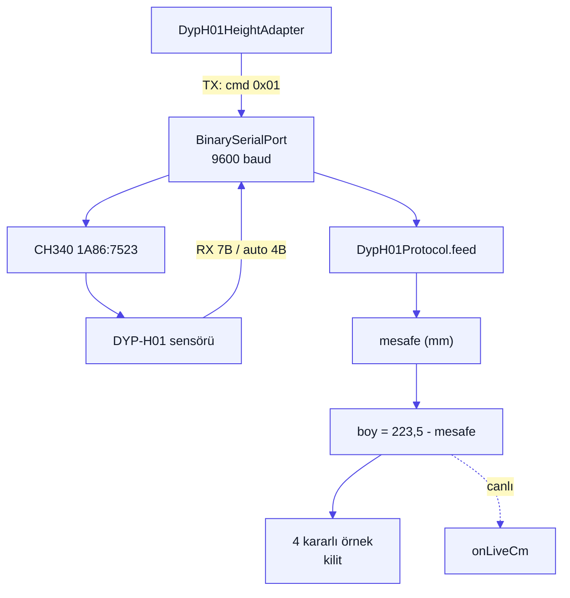

# DYP-H01 Boy (Mesafe) Sensörü

⬅ [Genel Mimari (Hub)](hub.md)

Kiosk tavanındaki DYP-H01 sensörü başın üstüne olan mesafeyi ölçer; boy, sabit bir referanstan çıkarılarak bulunur. Tur sırasında **ilk adımdır**.

## Bağlantı

| Özellik | Değer |
|---------|-------|
| USB köprüsü | CH340 (`1A86:7523`), Linux'ta `ch341-uart` → `ttyUSB0` (`etc/height/android-log.txt`) |
| Seri | **9600 baud** (OEM ASCII boyundan farklı: orada 4800) |
| Uygulama rolü | `HEIGHT_DYP` ([Donanım Keşfi](donanim-kesfi-ve-usb.md)) |

## Çerçeveler (`DypH01Protocol`)

- **TX (5 bayt)**: `55 AA <adres> <komut> <sağlama>`; sağlama = ilk dört baytın toplamının düşük baytı. Varsayılan adres `1`.
- **RX komut yanıtı (7 bayt)**: `55 AA <adres> <komut> <yüksek> <düşük> <sağlama>`; sağlama ilk altı baytın toplamı. Değer = `yüksek<<8 | düşük`.
- **RX otomatik (4 bayt)**: `FF <yüksek> <düşük> <sağlama>`; sağlama `(0xFF + yüksek + düşük) & 0xFF`, mesafe mm.
- Komutlar: `0x01` anlık mesafe, `0x02` sıcaklık, `0x05` filtrelenmiş mesafe. Ortam sıcaklığı dönüştürücüsü (`temperatureFromRaw`, 0.1 °C, 16 bit işaretli) tanımlıdır ama adaptör kullanmaz.
- Ayrıştırıcı arabellekli çalışır: hatalı sağlamada tek bayt atar ve yeniden senkronlanır.

## Boy hesabı

`boy_cm = max(0, 223,5 − mesafe_mm / 10)` (`REFERENCE_HEIGHT_CM = 223.5`, yani sensörün zemine göre referansı). Aynı 223,5 sabiti OEM ASCII boy protokolündeki formülde de geçer (`StandingHeight.SENSOR_OFFSET_CM`, `223.5 − ölçülen − kalibrasyon`; bkz. [OEM ASCII Protokolü](oem-ascii-protokolu.md)). Kalibrasyon düzeltmesi DYP yolunda uygulanmaz.

## Adaptör (`DypH01HeightAdapter`)

1. Her turda komut `0x01` gönderir, 64 bayta kadar okur, ~120 ms bekler.
2. `0x01` ve `0x05` komut yanıtlarını ve otomatik çerçeveleri kabul eder; `mesafe > 0` olanları işler.
3. Her geçerli örnekte `onLiveCm(cm)` çağrılır (ekranda anlık boy).
4. **Kilit kuralı**: art arda 4 örnek, birbirinden en çok **0,8 cm** farklıysa o değer kilitlenir.
5. 12 sn akış süresi dolarsa son geçerli örnek döner; hiç örnek yoksa `"DYP-H01 mesafe yanıtı alınamadı"` hatası.

`MeasurementSession` ayrıca 15 sn'lik dış zaman aşımı uygular ([Ölçüm Oturumu](olcum-oturumu.md)).

## Mock ve test

- `MockDypH01HeightAdapter(175.3)`: 170,3 → 173,3 → 174,8 → 175,3 rampası. Keşif mock'unda (`MockBinarySerialPortFactory`) sensör 482 mm döndürür; 223,5 − 48,2 = **175,3 cm**.
- `EtcProtocolParserTest.dypBuildsTxAndParsesFilteredDistance` TX çerçevesini ve filtrelenmiş mesafe yanıtını doğrular ([Test Stratejisi](test-stratejisi.md)).

## Kaynaklar ve araçlar

- `etc/height/H01-Datasheet.pdf`, `H01-Output-Interfaces.pdf`: taranmış/görüntü tabanlıdır, metin çıkarılamadı; bu sayfa protokol bilgisini **koddan** türetmiştir.
- `etc/height/python/dyp-h01.pyw`: PyQt6 + pyserial ile yazılmış laboratuvar test arayüzü (`dyp-h01-test.png` ekran görüntüsü). Android uygulamasının parçası değildir.

## İlgili

- [Donanım Keşfi ve USB](donanim-kesfi-ve-usb.md)
- [BerryMed SpO2](berrymed-ys2000a-spo2.md) · [HeTaiDa Ateş](hetaida-htd8808c-ates.md) · [Raycome Tansiyon](raycome-rbp7000-tansiyon.md)
