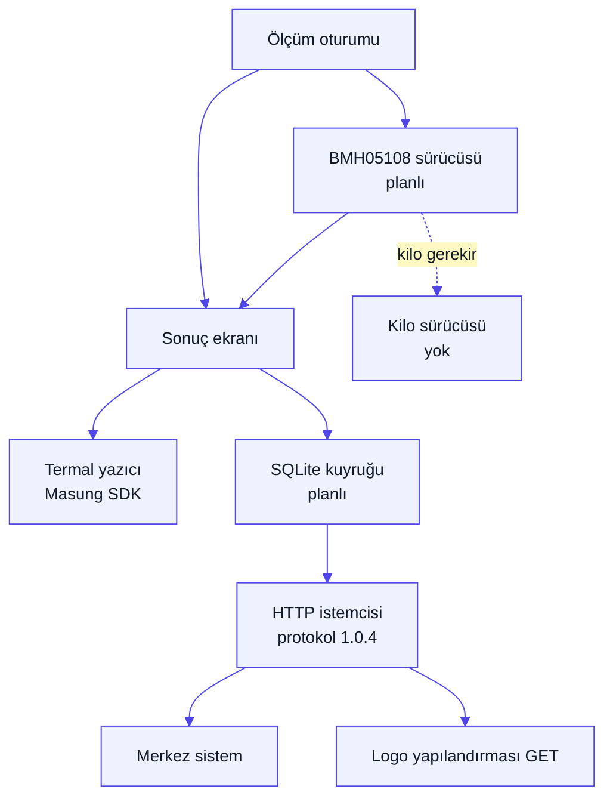

# Faz 2 — Termal Yazıcı, Vücut Analizi, Merkeze Yükleme

⬅ [Genel Mimari (Hub)](hub.md)

Bu sayfadaki üç kalem için **kodda henüz sürücü yoktur**; yalnızca tedarikçi belgeleri, SDK örnekleri ve plan notları vardır (`CLAUDE.md` yerleşim şeması `adapter/http/` ve `adapter/printer/` dizinlerini öngörür, gerçek ağaçta bulunmazlar).

## Masung termal yazıcı

- Kaynak: `docs/vendor/thermal-printer/` — "Masung Printers SDK Manual Android V3.0" (İngilizce ve Çince PDF), `PrintCom20201120.apk` ve `PrintDemoCom` Android demo projesi.
- Demo; JNA (`jna.jar`, `libjnidispatch.so`), `libmsprintsdk.so`, `libmsprintcom.so`, `libmsprintdata1.so` yerel kütüphaneleri (armeabi, armeabi-v7a, x86_64) ve JNI seri port kodunu (`SerialPort.c`) kullanır. Fizibilite raporu demo kodunun kopyalanmamasını, SDK komutlarının alınıp uygulamanın yeniden yazılmasını önerir (eski destek kütüphaneleri).
- Özellikler (rapor): metin, görüntü, barkod/karekod, kesim, durum sorgusu. Demo `chmod 666`/`su` varsayar; baud demo için 115200 olarak geçer. Kesim, kağıt bitişi, USB-seri farkı ve Türkçe karakter gerçek cihazda doğrulanmalıdır.
- `etc/` içindeki dört sensörün aksine yazıcının VID/PID kaydı `KnownUsbDevices` içinde yoktur ([Donanım Keşfi ve USB](donanim-kesfi-ve-usb.md)).

## BMH05108 — 8 elektrotlu vücut analizi

- Kaynak: `docs/vendor/Android body fat 8-electrode protocol.pdf`.
- Rapora göre: 38400 baud (USB CDC, isteğe bağlı BLE), master `0x55` / slave `0xAA` ikili çerçeve, little-endian, 100 ms yanıt zaman aşımı, ağırlık **jin ×10** biriminde (kg'a dönüşüm tek yerde yapılmalı), empedans, Body270 algoritması (`0xD0`), kalibrasyon ve ISP/upgrade komutları.
- Çıktılar HTTP sözleşmesindeki alanlarla örtüşür: yağ oranı, yağ kütlesi, bazal metabolizma, su, iskelet kası, viseral yağ, kemik mineral, hücre dışı/içi sıvı, protein, inorganik tuz, fiziksel yaş, bileşik skor.
- Ağırlık girdisi gerektirir; çalışan turda kilo sürücüsü olmadığı için bu kalem kilo ile birlikte düşünülmelidir ([Ölçüm Oturumu](olcum-oturumu.md)).
- Ürün tarafında INBCA kataloğundaki vücut kompozisyonu cihazları aynı sınıf bir ürüne işaret eder ([INBCA Ürün Kataloğu](inbca-urun-katalogu.md)); bu cihazın projedeki BMH05108 ile ilişkisi kaynaklarda yazılı değildir.

## HTTP yükleme (protokol 1.0.4, Mayıs 2024)

- Kaynak: `Android communication protrol API 1.0.4.docx`. Standart HTTP; cihaz yükleme adresine `http://` önekini kendisi ekler. Yanıt: `{"code": 1|0, "message": …}`.
- Yük alanları (hepsi String): kimlik (`userid`, `username`, `idcard`, `radioFrequency` IC kart, `socialCard`, `qrNumber`, `userface` Base64 yüz, `phone`, `email`, `sex` 1=erkek, `age`, `e_id` MAC) ve ölçümler (`body_temperature`, `height`, `weight`, `bmi`, yağ/su/kas/viseral/kemik alanları ve skorları, `blood_oxygen`, `blood_pressure_h`/`_l`, `heart_rate`).
- Uzaktan logo: `GET /api/whiteList/channel/common/logoConfig`; adres, yükleme adresinden türetilir. Alanlar `bmiStartLogoSwitch/Image`, `bmiCompanyLogoSwitch/Image`, `bmiMascotLogoSwitch/Image` (0/1 + URL).
- Uygulama yapılandırması `CLAUDE.md`'de SQLite çevrimdışı kuyruk olarak planlıdır; `build.gradle.kts`'te Room/SQLite bağımlılığı henüz yoktur (bağımlılık listesi: [Sağlık Kiosk Uygulaması](saglik-kiosk-app.md)). Diğer iki yükleme sözleşmesi (Pre-job v1.2, Smart health cabin v1.15) için: [Veri Yükleme Arayüzleri](veri-yukleme-arayuzleri.md).

## İlgili

- [Fizibilite Raporu](fizibilite-raporu.md)
- [Kiosk Arayüz Akışı](kiosk-ui-akisi.md)
