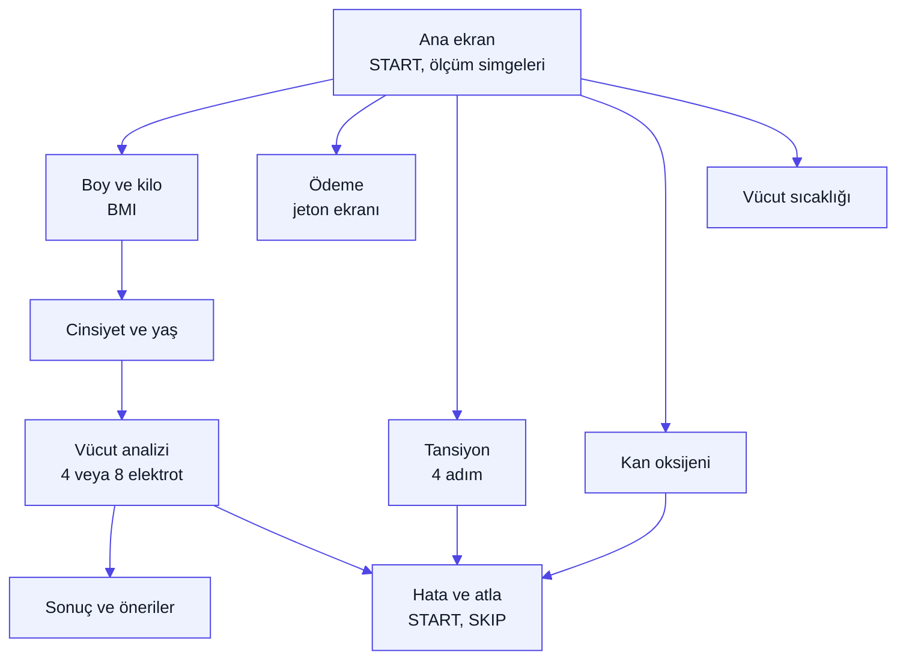

# Figma Ekran Tasarımı (Tedarikçi, İngilizce Standart)

⬅ [Genel Mimari (Hub)](hub.md)

`raw/saglik-kiosk/Figma/` klasörü, tedarikçinin kiosk arayüz tasarımının açılmış `.fig` dışa aktarımıdır (`meta.json`: dosya adı "英语 -标配" = "İngilizce – standart yapılandırma", dışa aktarım 2026-09-14). İçinde `canvas.fig` (Figma kiwi biçimi, ~460 KB), `thumbnail.png` ve `images/` altında 18 PNG (ekran/cihaz görselleri, çoğu 2347×4096 dikey) var. `docs/vendor/` altında aynı tasarımın tek dosyalık `.fig` kopyası da bulunuyor (adı bozuk karakterli; aynı dosya olduğu varsayımdır, doğrulanmadı).

**Not:** Bu sayfa `canvas.fig` içindeki metin katmanlarından ve küçük resimden çıkarılmıştır. Ekranları piksel düzeyinde incelemedim; akış sırası çerçeve adlarından çıkarımdır.

## Ekranlar (metin katmanlarına göre)

| Bölüm | İçerik |
|-------|--------|
| Ana ekran | "START" düğmesi; 12 ölçüm simgesi: sıcaklık, kan basıncı, kas, kemik, su, BMI, yağ, kalp hızı, boy, kan oksijeni, kilo, bazal metabolizma |
| Boy ve kilo | "Please stand straight on the platform"; BMI |
| Vücut analizi | Cinsiyet ve yaş seçimi ("Next"); 4 ve 8 elektrotlu iki varyant (`标配-四电极`, `标配-八电极`); hazırlık adımları (ayakkabı/çorap çıkar, tutamaçları kavra, dik dur, sonucu bekle); kontrendikasyon uyarısı (kalp pili, yapay kalp, taşınabilir EKG, hamilelik) ve "SKIP" |
| Vücut analizi sonucu | Vücut yağ/kas/su/kemik, iskelet kası, bazal metabolizma, viseral yağ, hücre içi/dışı sıvı, inorganik tuz, segment kas/yağ analizi, obezite tipleri, sağlık skoru, vücut yaşı, kilo yönetimi, egzersiz ve beslenme önerileri |
| Tansiyon | 4 adım: rahatla/ceket çıkar, kolu manşete yerleştir, kol kalple aynı hizada, ölçüm sırasında hareket etme; canlı basınç + "STOP"; sonuç: sistolik, diyastolik, nabız ve 4 sınıf (normal, hafif/orta/şiddetli hipertansiyon) |
| Kan oksijeni | Parmağı probun dibine yerleştir; "normal SpO2 %94'ün altına düşmemeli" açıklaması |
| Sıcaklık | Termometreyi alından 5 cm uzakta tut, düğmeye bas, "Beep" duyulunca bitti; ter, şapka, eşarp doğruluğu etkiler |
| Hata ekranları | "Measurement Error", "Press START to measure again / SKIP to cancel"; vücut analizinde: tutamaç yanlış, konum yanlış, yağ oranı aralık dışı, anormal hareket, 40 sn işlem yok |
| Ek modüller | Ödeme ("Coins still required", "Please insert coins"), "Please select the measurement item", görme keskinliği açıklaması, ölçek tabanlı sorgular (Çince madde metinleri ve semptom ölçeği; "Moderately Severe" gibi derecelendirme) |
| Tasarım sistemi | Renk/yazı stili belirteçleri (`color/主题色`, `font/一级标题`…), MiSans VF (ana), Arial/Tahoma; ayrıca "波兰" (Polonya) adlı ayrı renk varyantı |

## Mevcut uygulamayla karşılaştırma

| Konu | Tasarım | Uygulama ([Kiosk Arayüz Akışı](kiosk-ui-akisi.md)) |
|------|---------|------------------------------------------------------|
| Ölçümler | Boy/kilo, vücut analizi, tansiyon, SpO2, ateş (+ ödeme, görme, ölçek) | Boy, ateş, SpO2, tansiyon |
| Sıra | Ana ekrandan öğe seçimi ve "SKIP" ile atlama | Sabit tur; "Devam" sonucu atlayıp Sonuçlar'a gider |
| Dil | İngilizce (bu dosya); Çince/Lehçe varyantları ima ediliyor | Türkçe (`strings.xml`) |
| Hata dili | Ölçüme özel nedenler (kol yanlış, 40 sn hareketsiz) | Tansiyonda hata kodları → Türkçe ([Raycome](raycome-rbp7000-tansiyon.md)) |
| Vücut analizi | Tam ekran seti (4/8 elektrot) | Yok ([Faz 2](faz2-yazici-vucut-analizi-yukleme.md)) |

## Wikiye değeri ve kullanımı

Evet, değerli: uygulamanın hedef davranışını gösterir; özellikle (1) Faz 2 vücut analizi ekranları ve sonuç alanları, (2) tansiyon/SpO2/ateş için kullanıcıya gösterilecek talimat metinleri (Türkçeleştirilebilir), (3) hata/atla akışı, (4) tansiyon sınıflandırma eşikleri (ekranda 60/90/100/110/120 ve 140/160/180/200 işaretleri; sınıf eşleşmesi doğrulanmalı). Ödeme, görme ve ölçek ekranları şu an kapsam dışıdır; hangi yapılandırmanın ("standart") hedeflendiği kaynaklarda yazmıyor.

## İlgili

- [Kiosk Arayüz Akışı](kiosk-ui-akisi.md)
- [Fizibilite Raporu](fizibilite-raporu.md)
