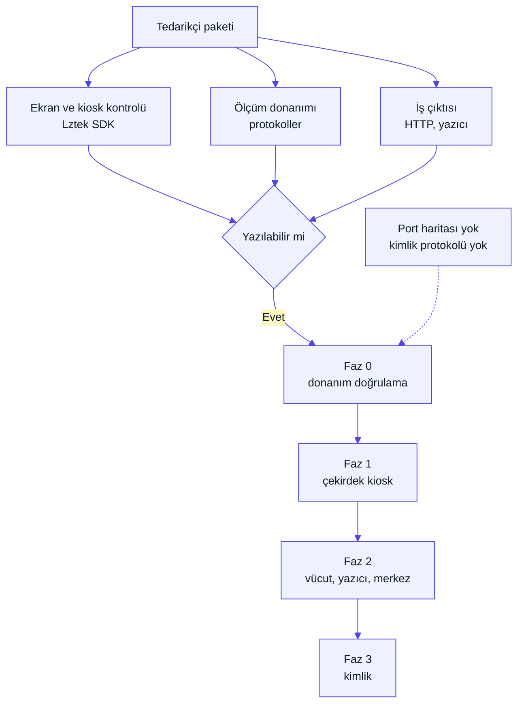

# Teknik Fizibilite Raporu (19 Eylül 2026)

⬅ [Genel Mimari (Hub)](hub.md)

Rapor, tedarikçi paketini (protokol belgeleri, Lztek SDK, yazıcı SDK'sı, örnek uygulamalar) inceler ve **"özel sağlık kiosk uygulaması yazılabilir" (Evet)** kararını önerir. Karar koşulludur: donanım ilk satır için değil, **entegrasyon, kabul ve üretim için zorunludur**. Pakette OEM kiosk uygulamasının kaynak kodu yoktur; `sdkdemo.apk` bir sağlık uygulaması değil, anakart test APK'sıdır.

## Modül değerlendirmesi (rapordan)

| Modül | Arayüz | Karmaşıklık | Not |
|-------|--------|-------------|-----|
| Boy | TTL 4800, `M…$` | Düşük | `223,5 − ölçülen − kalibrasyon` |
| Kilo | 4800, `#S…$` | Orta | `#SOK$` onayı, tara, kalibrasyon |
| Ateş | 4800, `#TM0$` | Düşük | Önce `#TMN$` ile uyandırma, ≥2 sn |
| SpO2 | 4800, `#XM0$` | Düşük | `C`/`E` durumu |
| Tansiyon ("Cemho") | 4800, `#BM0$` | Orta | 15+ hata kodu, Panasonic/Omron farkı |
| Vücut analizi BMH05108 | 38400 ikili, `0x55`/`0xAA` | Yüksek | Little-endian, 100 ms zaman aşımı, jin×10 |
| Termal yazıcı | USB/seri, Masung SDK v3.0 | Orta | [Faz 2](faz2-yazici-vucut-analizi-yukleme.md) |
| Merkez yükleme | HTTP JSON | Düşük | Protokol 1.0.4 |
| Kimlik (yüz, kart, karekod) | Yalnız HTTP alanları | Belirsiz | Donanım dokümanı yok |

## Riskler (özet)

Seri port eşlemesi belgesiz; aynı anda birden çok 4800 baud cihaz için yeterli UART gerekir; BMH05108 en uzun geliştirme kalemi; kimlik donanımı protokolsüz; OEM yazılımı ile port çakışması; tıbbi cihaz/iddia sınırı ("tarama/wellness", klinik iddia yok); KVKK (yüz, kimlik, ölçümler özel nitelikli veri); kalibrasyon; platform imzası/ROOT; yazıcı demosu eski kütüphanelere dayanıyor. Pakette regülasyon dosyası, klinik doğrulama raporu ve elektrik şeması yoktur.

## Fazlar ve kaba efor

| Faz | İçerik | Efor (donanım erişimiyle) |
|-----|--------|---------------------------|
| 0 | Port listesi, el sıkışma, yazıcı durumu, kiosk kilidi — **cihaz şart**, 1–2 hafta | — |
| 1 | Karşılama → boy, kilo, ateş, SpO2, tansiyon → özet; BMI yerelde; Türkçe | ~6–10 hafta |
| 2 | BMH05108, kompozisyon ekranı, termal rapor, HTTP 1.0.4, logo, çevrimdışı kuyruk | ~6–8 hafta |
| 3 | Yüz/kimlik/IC/karekod; HIS/PACS entegrasyonu | Dokümana bağlı |

Rapor bu aralıkların sözleşme taahhüdü olmadığını belirtir. Donanımsız yapılabilen işler (UI, ASCII çözücüler, HTTP istemcisi, uyandırma zamanlaması, BMH05108 çerçeve ayrıştırıcı) toplam eforun kabaca üçte biri–yarısıdır; kabul kriteri donanımsız yazılamaz ("parser yeşil ≠ kiosk ölçüm alıyor"). En geç entegrasyon sprint'inden önce bir tam kiosk ekipte olmalıdır.

## Rapor ve gerçek durum

Rapor, Lztek UART'a bağlı ASCII modüllere dayalı bir tasarım varsayar. Sahadaki kod ise dört **USB** cihaza (CH340, HID, Cypress, FTDI) göre gelişmiştir ve kilo, vücut analizi, yazıcı, HTTP yükleme ile SQLite kuyruğu henüz yoktur. Raporun port eşlemesi riski bu yüzden biçim değiştirmiştir: artık "hangi `/dev/tty*`" değil "hangi VID/PID hangi rol" sorusu vardır ([Donanım Keşfi ve USB](donanim-kesfi-ve-usb.md)). Fark tablosu: [Hexagonal Mimari](hexagonal-mimari.md).

## İlgili

- [OEM ASCII Protokolü](oem-ascii-protokolu.md)
- [Lztek Anakart](lztek-anakart.md)
- [Faz 2: Yazıcı, Vücut Analizi, Yükleme](faz2-yazici-vucut-analizi-yukleme.md)
- [Veri Yükleme Arayüzleri](veri-yukleme-arayuzleri.md)
