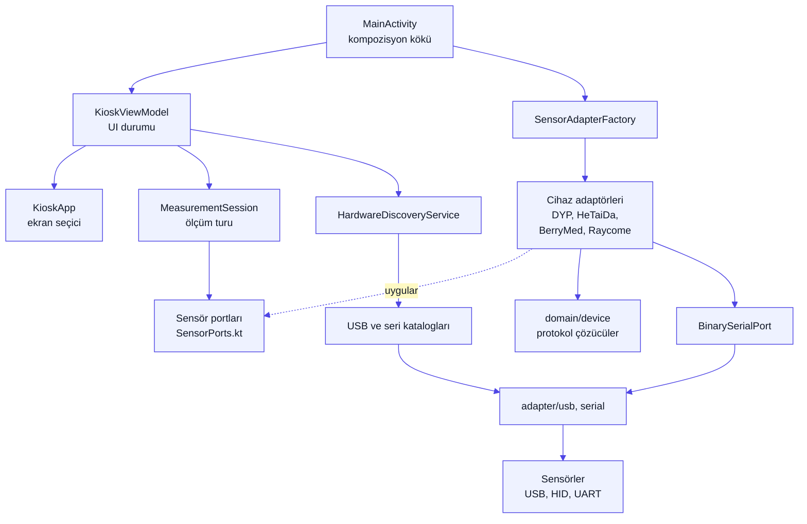
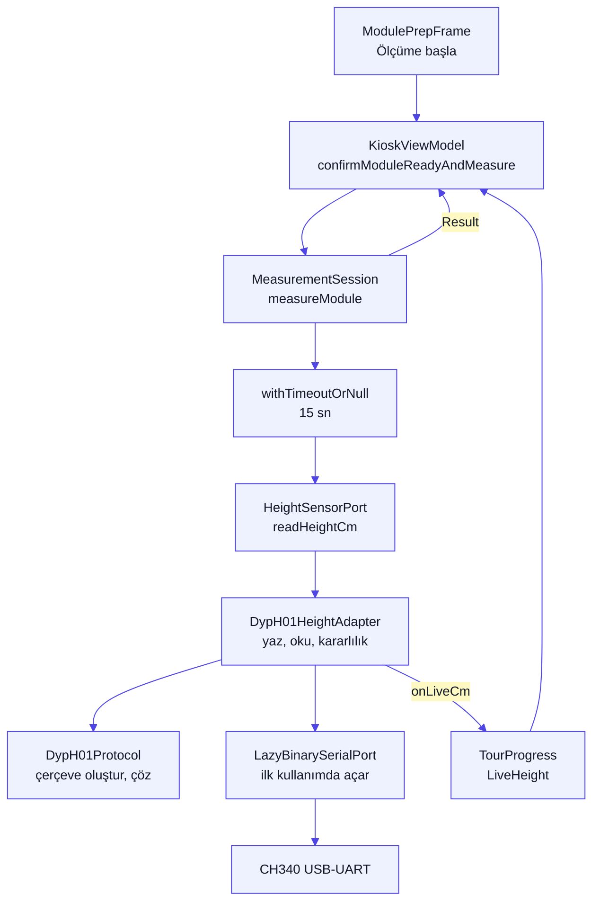
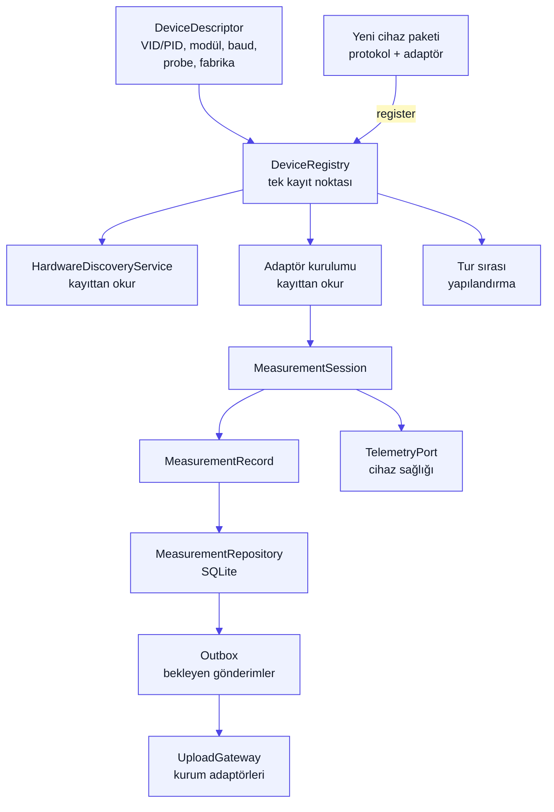

# Geliştirici Rehberi (C# / C++ Qt Geçmişi İçin)

⬅ [Genel Mimari (Hub)](hub.md)

Kod tabanı 75 Kotlin dosyası, yaklaşık 6.000 satırdır. Aşağıdaki anlatım `app/src/main/java/tr/com/innova/saglikkiosk/` altındaki gerçek dosyalara dayanır. **Bölüm 6–7 benim önerimdir**, kaynakta bulunmaz.

## 1. C# / Qt ↔ Kotlin sözlüğü

| Bu projede | C# karşılığı | Qt / C++ karşılığı |
|------------|--------------|--------------------|
| `interface` (port) | `interface` | saf sanal sınıf (`virtual … = 0`) |
| `class X : Port` | sınıf, interface'i uygular | türetilmiş sınıf |
| `suspend fun` | `async Task<T>` / `await` | `QFuture` / coroutine; bloklamaz |
| `delay(ms)` | `await Task.Delay` | `QTimer::singleShot` (bloklamaz) |
| `withTimeoutOrNull` | `CancellationTokenSource` + zaman aşımı | `QTimer` + iptal |
| `sealed interface` + alt tipler | sınıf hiyerarşisi / `OneOf` | `std::variant` |
| `data class` | `record` | değer yapısı (`struct`) |
| `object` | `static class` / singleton | sınıf + statik üyeler |
| `StateFlow<UiState>` | `IObservable<T>` / `INotifyPropertyChanged` | `Q_PROPERTY` + `NOTIFY` sinyali |
| `ViewModel` | MVVM ViewModel | QML'e açılan `QObject` |
| `@Composable` fonksiyon | XAML/Blazor bileşeni | QML bileşeni; durum değişince yeniden çizer |
| `Activity` | `Window` / `MainWindow` | `QMainWindow` |
| `AndroidManifest.xml` | `app.manifest` + izinler | `.pro` + platform izinleri |
| Gradle (`build.gradle.kts`) | MSBuild / csproj + NuGet | CMake / qmake |
| `Context` | `IServiceProvider` benzeri | `QApplication` / platform bağlamı |
| `ByteArray` | `byte[]` | `QByteArray` |
| `Result<T>` / `runCatching` | `try/catch` sarmalı | `std::expected` |
| `by lazy`, `Lazy…Port` | `Lazy<T>` | gecikmeli açma (RAII ile) |

Önemli fark: arayüz **deklaratif**. Siz widget'ı elle güncellemezsiniz; `KioskUiState` değişince Compose ilgili ekranı yeniden çizer (QML'deki property binding gibi).

## 2. Bileşen diyagramı

Okuma kuralı: oklar "bağımlıdır" demektir. `domain` ve `application/port` hiçbir şeye bağlı değildir; `adapter` onları uygular. Bu, C#'taki "Clean/Hexagonal" düzeninin aynısıdır.

## 3. Bir ölçümün yolu (örnek: boy)

1. Kullanıcı düğmeye basar; `KioskViewModel` oturumu kotlin coroutine içinde başlatır (UI iş parçacığını bloklamaz).
2. `MeasurementSession.measureModule` modülü `when` ile ilgili porta yönlendirir ve zaman aşımı koyar (boy 15 sn, ateş 30 sn, SpO2 75 sn, tansiyon 200 sn).
3. Adaptör cihazla konuşur: isteği yazar, baytları okur, protokol sınıfı çerçeveyi çözer. Anlık değerleri geri çağrımla (`onLiveCm`) yayınlar.
4. Sonuç `MeasurementResult` (sealed) olarak döner; hata `MeasurementError` ile taşınır. ViewModel durumu günceller, ekran yeniden çizilir.

## 4. Dosya haritası

Yol öneki: `app/src/main/java/tr/com/innova/saglikkiosk/`

### Kök
| Dosya | Görevi |
|-------|--------|
| `MainActivity.kt` | **Kompozisyon kökü** (DI konteyneri yerine elle). USB host/Lztek varlığına göre gerçek veya mock donanımı seçer, katalogları ve adaptörleri kurar |
| `SaglikKioskApplication.kt` | Boş `Application` sınıfı |
| `BootCompletedReceiver.kt` | Açılışta uygulamayı başlatır (kiosk) |

### `domain/` — saf kurallar, Android'e bağımlı değil

**Model sınıfları:**
- `VitalModule.kt` — Modül listesi: HEIGHT, WEIGHT, TEMPERATURE, SPO2, BLOOD_PRESSURE
- `MeasurementResult.kt` — Sonuç tipleri (Height, Weight, Temperature, Spo2, BloodPressure)
- `MeasurementError.kt`, `ParseResult.kt` — Hata ve ayrıştırma sonucu (Locked / Preview / Progress / Failed)

**İş mantığı:**
- `TourModuleOrder.kt`, `TourProgress.kt`, `TourOutcome` — Tur sırası ve ilerleme olayları
- `BodyMassIndex.kt`, `StandingHeight.kt` — BMI ve boy ofseti hesabı
- `HardwareInventory.kt`, `UsbDeviceInfo.kt` — Keşif sonucu modelleri

**Donanım keşfi (probe) ve protokoller:**
- `EtcDeviceProbes.kt`, `VitalModuleProbe.kt` — Keşifte hangi cihaza nasıl yoklanacağı
- `AttachedEtcSensors.kt` — USB envanterinden "hangi modüller takılı"
- `device/KnownUsbDevices.kt` — **VID/PID tablosu ve `UsbSensorRole` eşlemesi**
- `device/DypH01Protocol.kt`, `BerryMedBciParser.kt`, `HetaidaPacketParser.kt`, `RaycomeRbp7000Protocol.kt` — **Her cihazın protokolü** (çerçeve kur/çöz, sabitler); saf fonksiyonlar, birim testli

**OEM ASCII (eski yığın):**
- `AsciiFrame.kt`, `VitalCommands.kt`, `VitalProtocolParser.kt` 
- `HeightParser`, `WeightParser`, `TemperatureParser`, `Spo2Parser`, `BloodPressureParser.kt`
- `BloodPressureErrorCodes.kt`
- Detaylar: [OEM ASCII Protokolü](oem-ascii-protokolu.md)                           |

### `application/` — iş akışı ve portlar
| Dosya | Görevi |
|-------|--------|
| `port/SensorPorts.kt` | **Sensör arayüzleri**: `HeightSensorPort`, `TemperatureSensorPort`, `Spo2SensorPort`, `BloodPressureSensorPort` |
| `port/BinarySerialPort.kt`, `BinarySerialPortFactory.kt` | Ham bayt taşıma: `write / read / close`; `open(path, baud)` |
| `port/HidInterruptPort.kt`, `AsciiSerialPort.kt`, `SerialPortCatalog.kt`, `UsbDeviceCatalog.kt` | HID, ASCII, port ve USB listeleme arayüzleri |
| `MeasurementSession.kt` | **Ölçüm orkestrasyonu**: zaman aşımı, hata eşleme, tur |
| `HardwareDiscoveryService.kt` | Cihaz keşfi: USB kimliği ve seri sondalama |

### `adapter/` — gerçek dünya
| Dosya | Görevi |
|-------|--------|
| `SensorAdapterFactory.kt` | **Adaptör seti kurulumu** (`mockSuite`, `boardSuite`) |
| `dyp/`, `berrymed/`, `raycome/`, `hetaida/` | Cihaz adaptörleri: port arayüzünü uygular, protokol sınıfını kullanır |
| `hetaida/HidrawInterruptPort.kt` | `/dev/hidraw*` üzerinden HID okuma (root gerekebilir) |
| `serial/` | `LazyBinarySerialPort` (gecikmeli açma), `StreamBinarySerialPort`, mock'lar, dosya sistemi kataloğu |
| `usb/` | USB katalogları (Android API, sysfs), `UsbHostCoordinator` (izinler), `UsbSerialBinaryPortFactory`, `TtyBinarySerialPortFactory`, `CompositeBinarySerialPortFactory` (hangi yolla açılacak) |
| `lztek/` | Lztek anakart köprüsü ([Lztek](lztek-anakart.md)) |

### `ui/`
| Dosya | Görevi |
|-------|--------|
| `KioskViewModel.kt` | **Tüm UI durumu ve eylemler** (389 satır, en büyük mantık dosyası) |
| `KioskApp.kt`, `KioskScreen.kt` | Durum → ekran eşleme, ekran listesi |
| `screens/*.kt` | Ana ekran, hazırlık, ölçüm, sonuç, uyarı, port ekranları |
| `frames/FrameChrome.kt`, `theme/KioskTheme.kt` | Ortak çerçeve ve tema |

Ayrıntılı sayfalar: [Hexagonal Mimari](hexagonal-mimari.md), [Ölçüm Oturumu](olcum-oturumu.md), [Donanım Keşfi](donanim-kesfi-ve-usb.md), [Kiosk Arayüz Akışı](kiosk-ui-akisi.md).

## 5. Bugün yeni cihaz eklemek ne kadar kolay?

**Dürüst cevap: kolay değil.** Cihaz listesi kodda birçok yere sabit yazılmış; bir "cihaz kaydı" (registry) yok. Dördüncü sınıf bir sensör (örneğin yeni bir termometre) eklemek için bugün dokunulacak yerler:

1. `domain/device/<Cihaz>Protocol.kt`: çerçeve kur/çöz, baud, sabitler (+ birim test).
2. `domain/device/KnownUsbDevices.kt`: yeni `Identity(VID, PID, ad)` ve `ALL` listesi.
3. Aynı dosyada `UsbSensorRole` enum'u ve `UsbSensorRoleMap.roleFor` (`when` zinciri).
4. `application/port/SensorPorts.kt`: sensör zaten bir modüle aitse mevcut portu kullanın, yeni bir ölçüm türüyse yeni port.
5. `adapter/<cihaz>/<Cihaz>Adapter.kt`: portu uygulayın, mock sürümünü de yazın.
6. `adapter/SensorAdapterFactory.kt`: `SensorAdapterSuite`, `mockSuite`, `boardSuite`.
7. `MainActivity.kt`: yol belirtecini (`pathToken`) fabrikaya geçirin.
8. `domain/AttachedEtcSensors.kt` ve `domain/EtcDeviceProbes.kt` (+ `HardwareDiscoveryService` içinde yeni `probe…`): keşif ve "takılı mı" tespiti.
9. Yeni ölçüm türüyse: `VitalModule`, `MeasurementResult`, `MeasurementSession.measure/timeoutFor`, `TourModuleOrder`, `KioskViewModel`, `res/values/strings.xml` ve sonuç/hazırlık ekranları.
10. `res/xml/usb_device_filter.xml`: USB izin ve otomatik başlatma filtresi.

Ek sınırlamalar:
- **Rol çakışması:** CH340, FTDI ve Cypress kimlikleri yalnız bir role bağlı. Aynı çipli ikinci cihaz yanlış role düşer ([Donanım Keşfi](donanim-kesfi-ve-usb.md)).
- Adaptör seti yalnız dört sensörü içerir (`SensorAdapterSuite`), sabit.
- Yeni modül UI'da sabit tur sırasına (`TourModuleOrder`) girer.

## 6. Önerilen hedef mimari (öneri, kodda yok)

Cihaz eklemeyi "tek dosya + tek kayıt" hâline getirmek için, C#'taki plugin/keyed-service düzenine benzer bir **cihaz tanımlayıcı** (`DeviceDescriptor`) önerilir:

Somut adımlar:
- `DeviceDescriptor`: modül, VID/PID listesi, baud, rol, `probe` stratejisi ve `adapterFactory`. `KnownUsbDevices`, `UsbSensorRoleMap`, `EtcDeviceProbes` ve `SensorAdapterFactory` bu kayıttan beslenir; enum ve `when` zincirleri azalır.
- Rol çakışmasını çözmek için kimliğin yanında **seri numarası veya USB port yolu** eşlemesi (yapılandırma dosyası) eklenir.
- Tur sırası ve etkin modüller koda değil yapılandırmaya taşınır.

## 7. Kayıt, telemetri ve kurum entegrasyonu için öneri

Bugün **hiçbiri yok** (sonuçlar yalnızca bellekte, ekranda). Kaynaklardaki sözleşmeler ([Veri Yükleme Arayüzleri](veri-yukleme-arayuzleri.md), [Faz 2](faz2-yazici-vucut-analizi-yukleme.md)) şu tasarımı destekler:

| İş | Öneri | Not |
|----|-------|-----|
| **Yerel kayıt** | Domain'e `MeasurementRecord` (oturum kimliği, zaman, kullanıcı alanları, `MeasurementResult` listesi, cihaz kimliği) ve `MeasurementRepository` portu; adaptör: SQLite (Room) | `CLAUDE.md` zaten SQLite kuyruğu öngörür; `build.gradle.kts`'te henüz yok |
| **Güvenilir gönderim** | **Outbox**: kayıt ile gönderim kaydı aynı işlemde yazılır; arka planda `WorkManager` işi gönderir | Kaynak sözleşmelerdeki yeniden deneme kuralı: 5 sn, 10 sn, 1 dk, 5 dk, sonra saatlik; 120 saat sonra veri atılır |
| **Kurum entegrasyonu** | `UploadGateway` portu; her sözleşme için ayrı adaptör (1.0.4 düz alanlar, Pre-job v1.2 / Cabin v1.15 `Member`+`Record`+`Items`) | Hangisi kullanılacağı belirsiz; port sayesinde birden çok kurum aynı anda desteklenir |
| **Kullanıcı kimliği** | `Member` alanları (ad, kimlik no, doğum tarihi, yüz) için ayrı `ParticipantProvider` portu | Faz 3; donanım dokümanı yok |
| **Telemetri** | `TelemetryPort`: cihaz çevrimiçi sinyali (Pre-job: dakikada bir, 3 dk sessizlik = çevrimdışı), sensör sağlığı, hata sayaçları, sürüm | Hassas veri taşımayın; yalnız teknik metrik |
| **Uzaktan yapılandırma** | Eşik değerleri (`GetLis_limittypeedit…`), logo (`logoConfig`) ve cihaz kaydı (`addHostInfo`) için `RemoteConfigPort` | Sözleşmelerde tanımlı uç noktalar |
| **Güvenlik / KVKK** | Şifreli aktarım (HTTPS), yerelde saklama süresi, açık rıza, kişisel veriyi loglamama | [Fizibilite Raporu](fizibilite-raporu.md) risklerinde geçer |

Bu yapı mevcut hexagonal düzenle uyumludur: yeni işler yeni portlar ve adaptörlerdir, `MeasurementSession` ve `domain` yalnızca `MeasurementRecord` üretmeyi öğrenir.

## 8. Başlangıç için önerilen sıra

1. Mock modda çalıştırın ve `MeasurementSessionTest` ile `EtcProtocolParserTest` testlerini okuyun ([Test Stratejisi](test-stratejisi.md)).
2. Basit bir cihazı (`DypH01Protocol` + `DypH01HeightAdapter`) satır satır okuyun.
3. Bölüm 5'teki listeyle kuru bir "yeni cihaz" denemesi yapın; her adımda nelerin elle bağlandığına dikkat edin.
4. `DeviceDescriptor` refaktörüne ve `MeasurementRecord` + outbox tasarımına başlamadan önce yükleme sözleşmesini (hangisi?) netleştirin.

## İlgili

- [Hexagonal Mimari ve Portlar](hexagonal-mimari.md)
- [Faz 2: Yazıcı, Vücut Analizi, Yükleme](faz2-yazici-vucut-analizi-yukleme.md)
- [Test Stratejisi](test-stratejisi.md)
