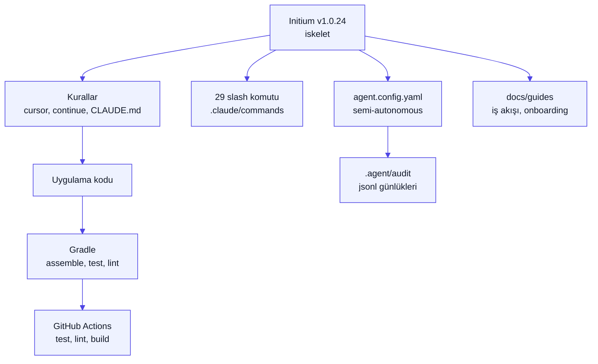

# Geliştirme Süreci

⬅ [Genel Mimari (Hub)](hub.md)

Proje **Initium v1.0.24** iskeletinden türetilmiştir ("endüstriyel Android sağlık kiosk prototipi"). Bu yüzden kökte uygulamayla ilgisi olmayan, jenerik bir YZ-yerel geliştirme altyapısı bulunur; uygulamaya özgü kurallar `CLAUDE.md` ve `docs/context/` altındadır.

## Komutlar

`./gradlew :app:assembleDebug`, `./gradlew test`, `./gradlew lint`, `./gradlew :app:assembleRelease`; iskelet doğrulaması `bash .initium/scripts/validate.sh`. Gradle sarmalayıcı 8.11.1, JVM 17 ([Sağlık Kiosk Uygulaması](saglik-kiosk-app.md)).

## CI (`.github/workflows/ci.yml`)

`main` ve `develop` üzerinde push/PR ile çalışır; aynı dal için eşzamanlı çalışmalar iptal edilir. Üç iş: **Test** (`./gradlew test`), **Lint** (`./gradlew lint`) ve onlara bağlı **Build** (`:app:assembleDebug`). Hepsi `ubuntu-latest`, Temurin 17 ve `android-actions/setup-android@v3` kullanır. Donanım gerektiren testler CI'da çalışmaz; yalnız birim testler ([Test Stratejisi](test-stratejisi.md)).

## Derleme ve Kurulum Adımları

Kaynaklar: `CLAUDE.md`, `settings.gradle.kts`, `app/build.gradle.kts`, `gradle.properties`, `gradle-wrapper.properties`, `ci.yml`. Bu adımlar dosyalardan çıkarılmıştır; bu çalışmada derleme **çalıştırılmadı**.

### Ön koşullar

| Gereksinim | Değer | Kaynak |
|------------|-------|--------|
| JDK | 17 (`jvmTarget`, CI Temurin 17) | `app/build.gradle.kts` |
| Android SDK | `compileSdk`/`targetSdk` 35, `minSdk` 24; yolu `local.properties` içindeki `sdk.dir` (makineye özel, depoya girmemeli) | `local.properties` |
| Gradle | Sarmalayıcı 8.11.1 (`./gradlew`; indirme `services.gradle.org`) | `gradle-wrapper.properties` |
| Ağ | `google()`, `mavenCentral()`, `gradlePluginPortal()` ve **JitPack** (`usb-serial-for-android` için) | `settings.gradle.kts` |
| Bellek | `org.gradle.jvmargs=-Xmx2048m` | `gradle.properties` |
| Lztek JAR | `app/libs/sdkapi.jar` depoda hazır (`compileOnly`) | `app/build.gradle.kts` |

### Adımlar

1. Depoyu klonlayın; `local.properties` içine kendi `sdk.dir` yolunuzu yazın (Android Studio otomatik yapar). Windows'ta `gradlew.bat`, Linux/macOS'ta önce `chmod +x gradlew`.
2. Debug APK: `./gradlew :app:assembleDebug` (CI'daki Build işi de aynısını yapar; çıktı `app/build/outputs/apk/debug/`).
3. Birim testler: `./gradlew test`; lint: `./gradlew lint`.
4. Release APK: `./gradlew :app:assembleRelease`. `isMinifyEnabled=false`, `proguard-rules.pro` boş; **imzalama yapılandırması yok**, imzasız APK çıkar.
5. Kuruluma ilişkin: uygulama `HOME` launcher olarak çalışır (ilk açılışta varsayılan seçilmeli) ve açılışta `BootCompletedReceiver` ile başlar; USB izni ve kök erişim konuları [Donanım Keşfi ve USB](donanim-kesfi-ve-usb.md) sayfasında. Sessiz kurulum (Lztek) kodda kullanılmıyor ([Lztek Anakart](lztek-anakart.md)).

### Notlar ve tuzaklar

- `sdkapi.jar` yalnız derleme zamanı içindir; sınıflar kart firmware'inde bulunur. Standart telefonda/emülatörde Lztek çağrıları başarısız olur ve uygulama sahte (mock) donanıma düşer ([Sağlık Kiosk Uygulaması](saglik-kiosk-app.md)).
- JitPack erişilemezse `usb-serial-for-android` çözülemez; kurumsal ağda bu adres izin listesinde olmalı.
- `etc/*/python/` altındaki PC test araçları (`*.pyw`) ayrı çalışır: PyQt6 + `pyserial` (boy, SpO2, tansiyon), SpO2 için ayrıca `pyqtgraph`, ateş için `hidapi`. Bunlar Android derlemesinin parçası değildir.
- Derleme çıktıları (`build/`, `app/build/`) depoda duruyor; temiz derleme için silinebilir.

## YZ iş akışı

- **Kurallar**: `.cursor/rules/00–05` (proje özeti, kodlama, mimari, test, git, güvenlik) ve `skills/` altında dil/çatı kuralları (mobile-android dahil); Continue için eşleniği. Mimari kural: Hexagonal + Adapter, vendor SDK'ya domain/application'dan çağrı yok ([Hexagonal Mimari](hexagonal-mimari.md)).
- **Komutlar**: `.claude/commands/` altında 29 komut (`requirements`, `architect`, `implement`, `qa`, `review`, `test`, `security-audit`, `deploy`, `sprint`, `triage`, `loop`, `goal`…).
- **Ajan**: `agent.config.yaml` — kimlik `saglik-kiosk-agent`, mod `semi-autonomous`, iş kaynağı GitHub. Jira alanları (`UNSET`, `${JIRA_URL}`) doldurulmamış şablon değerlerdir.
- **Denetim izi**: `.agent/audit/` altında 2026-09-19 ve 2026-09-21 tarihli `commands`, `sessions`, `writes` jsonl günlükleri (toplam 143 satır); proje 19 Eylül 2026'da başlamış görünür (ADR 0001 ve fizibilite raporu aynı tarihli).
- **Kılavuzlar**: `docs/guides/` altında ai-workflow, onboarding, team (EN/TR) ve 7 iş akışı belgesi (gereksinim, özellik geliştirme, test stratejisi, dağıtım, güvenlik, veritabanı göçü, dağıtım platformları) — jenerik şablondur.

## Şablon kalıntıları ve eksikler

| Konu | Durum |
|------|-------|
| `SECURITY.md` | Şablon: sürüm tablosu ve iletişim e-postası `TODO` |
| `CONTRIBUTING.md` | Initium'un kendisine katkı rehberi (bu uygulama için değil) |
| Jira ayarları | Doldurulmamış |
| `build/reports/problems/…html` ve `app/build/` | Derleme çıktıları depoya girmiş |
| Gizli bilgiler | `.env` bu çalışmada bilerek okunmadı; `local.properties` yerel SDK yolu içerir |

## İlgili

- [Test Stratejisi](test-stratejisi.md)
- [Sağlık Kiosk Uygulaması](saglik-kiosk-app.md)
