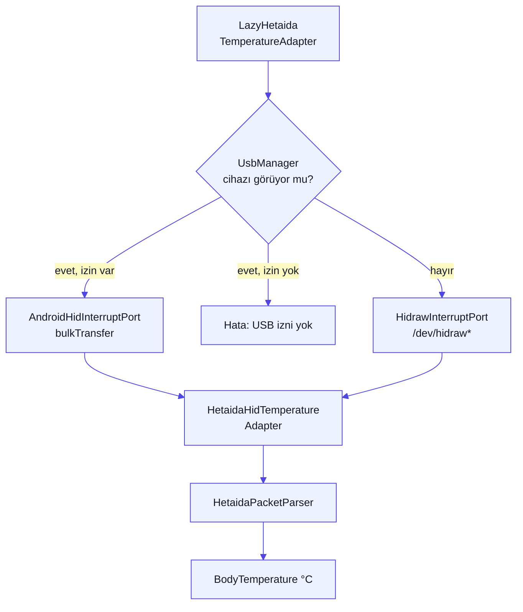

# HeTaiDa HTD8808C Ateş (HID) Termometresi

⬅ [Genel Mimari (Hub)](hub.md)

Diğer üç cihazdan farklı olarak **seri port değil, USB HID** cihazdır; bu yüzden ayrı bir port (`HidInterruptPort`) kullanır. Tur sırasında ikinci adımdır.

## Bağlantı

| Özellik | Değer |
|---------|-------|
| USB | SONiX `0C45:7702`, düşük hızlı HID; çekirdek `hid-generic` → `hidraw0` (`etc/thermometer/android-log.txt`) |
| Rol | `TEMPERATURE_HETAIDA`; HID olduğundan `UsbHostSerialPortCatalog` seri aday olarak eklemez |
| Görünürlük | Rockchip kartlarda `UsbManager` HID'i listelemeyebilir; sysfs/hidraw yolu bu yüzden vardır ([Donanım Keşfi](donanim-kesfi-ve-usb.md)) |

## Paket biçimi

`0x5E` ile başlar, `0x0D` ile biter:

`5E [bellek kodu 2B ASCII] [durum baytı] [ASCII veri…] 0D`

- Veri örneği `36.5C`: sondaki `C`/`F` birimdir (yoksa °C varsayılır); `F` ise `(F−32)·5/9` ile °C'ye çevrilir. Baştaki gereksiz sıfırlar atılır.
- Özel değerler: `TbLo`/`TaLo` → "Lo", `TbHi`/`TaHi` → "Hi" (`HetaidaReading.Special`).
- Sayıya çevrilemeyen veri `null` döner (paket yok sayılır).

## Adaptör ve taşıma

`HetaidaHidTemperatureAdapter`: en çok **40 rapor** okur (rapor yoksa 50 ms bekler); ilk `BodyTemperature` paketini döndürür, `Special` ise `"Termometre uyarısı: Lo/Hi"` hatası, hiç paket yoksa `"HeTaiDa sıcaklık paketi alınamadı"`. `MeasurementSession` zaman aşımı 30 sn.

`LazyHetaidaTemperatureAdapter` taşımayı ölçüm anında seçer:

1. **UsbManager** cihazı bulursa: izin yoksa `"HeTaiDa için USB izni yok — cihazı yeniden takın veya izin verin"` hatası verir (hidraw'a **düşmez**); izin varsa `HetaidaUsb.openInterruptPort` ile arayüz 0'ın IN uç noktasından `bulkTransfer` (120 ms zaman aşımı) okur.
2. Bulamazsa **hidraw**: `/sys/class/hidraw/*/device/uevent` içinde `HID_ID=0003:VID:PID` eşleşmesi aranır; düğüm okunamıyorsa `su 0 chmod 666 <yol>` denenir, başarısızsa "root chmod veya udev kuralı gerekli" hatası.

## Mock ve test

`MockHetaidaTemperatureAdapter` 36,5 °C döndürür. Testler: `hetaidaDecodesBodyTemperaturePacket`, `HidrawInterruptPortTest.findPathMatchesVidPidFromUevent` ([Test Stratejisi](test-stratejisi.md)).

## Kaynaklar

`etc/thermometer/UART data Transmission format _V15_HeTaiDa_20250425.pdf` (UART belgesi; bu sayfa için okunmadı, HID paket bilgisi koddan alınmıştır), `etc/thermometer/python/hetaida-htd8808c.pyw` (PyQt6 + hidapi test aracı).

Eski OEM ASCII dilinde ateş için ayrıca uyandırma kuralı vardır (`#TMN$`, ≥2 sn bekle, sonra `#TM0$`); HID yolunda böyle bir adım uygulanmaz ([OEM ASCII Protokolü](oem-ascii-protokolu.md)).

## İlgili

- [Donanım Keşfi ve USB](donanim-kesfi-ve-usb.md)
- [Ölçüm Oturumu](olcum-oturumu.md)
