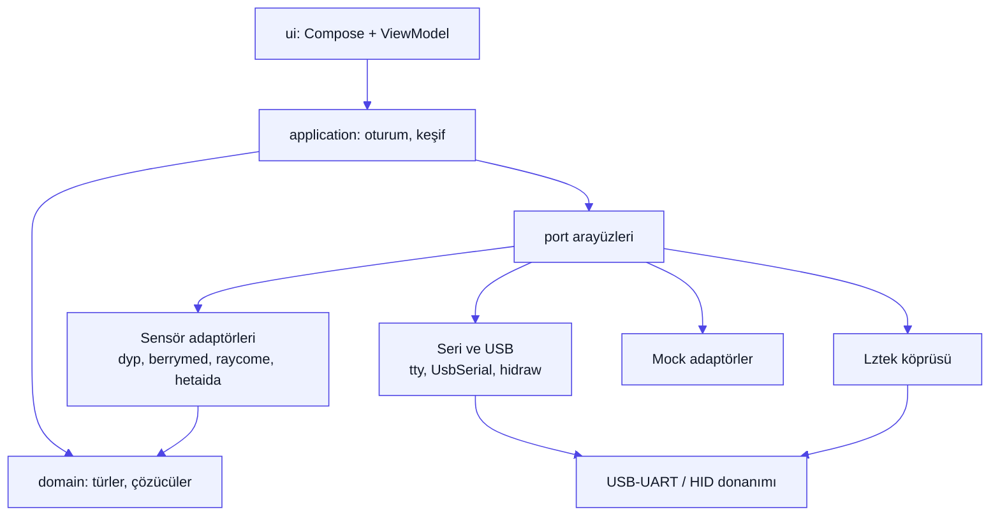

# Hexagonal Mimari ve Portlar

⬅ [Genel Mimari (Hub)](hub.md)

Karar kaydı **ADR 0001 — Hexagonal cihaz adaptörleri** (Accepted, 2026-09-19): domain ve UI tedarikçi SDK'sı çağırmaz; seri/USB erişimi bir port arkasındadır; anakart değişirse yalnız `adapter.lztek`, modül değişirse yalnız ilgili sürücü değişir. `CLAUDE.md` "Do Not" listesi: `domain/` veya `ui/` içinde Lztek/Masung/BMH05108 SDK'sı çağrılmaz.

## Katmanlar

| Katman | Sorumluluk | Not |
|--------|-----------|-----|
| `domain` | `MeasurementResult`, `MeasurementError`, `ParseResult`, `VitalModule`, BMI, USB rol haritası, **cihaz protokolleri** (`domain/device`) | Android sınıfı kullanmaz |
| `application` | `MeasurementSession`, `HardwareDiscoveryService`, `TourOutcome`, port arayüzleri | Coroutines |
| `adapter` | Cihaz sürücüleri, seri/USB taşıma, Lztek köprüsü, mock'lar | Android/Lztek/usb-serial burada |
| `ui` | `KioskViewModel`, `KioskApp`, ekran composable'ları | Sensör paketi ViewModel'e verilir |

## Port arayüzleri (`application/port`)

| Port | İmza özeti | Uygulayanlar |
|------|-----------|--------------|
| `HeightSensorPort` | `readHeightCm(onLiveCm)` → `Height` | `DypH01HeightAdapter`, `MockDypH01HeightAdapter` |
| `TemperatureSensorPort` | `awaitBodyTemperatureC()` → `Temperature` | `HetaidaHidTemperatureAdapter`, `LazyHetaidaTemperatureAdapter`, mock |
| `Spo2SensorPort` | `awaitStableSpo2(onSample)` → `Spo2` | `BerryMedSpo2Adapter`, mock |
| `BloodPressureSensorPort` | `measure(onStatus)` → `BloodPressure` | `RaycomeBloodPressureAdapter`, mock |
| `BinarySerialPort` / `BinarySerialPortFactory` | ham bayt `read/write/close`; `open(path, baud)` | `StreamBinarySerialPort`, `LazyBinarySerialPort`, `UsbSerialBinaryPort`, `TtyBinarySerialPortFactory`, `LztekBinarySerialPortFactory`, `CompositeBinarySerialPortFactory`, mock |
| `AsciiSerialPort` / `SerialPortFactory` | `writeAscii`/`readAscii` (`#…$`) | `LztekAsciiSerialPort`, `MockSerialPort` ([OEM ASCII Protokolü](oem-ascii-protokolu.md)) |
| `HidInterruptPort` | `readReport()` | `AndroidHidInterruptPort`, `HidrawInterruptPort` |
| `SerialPortCatalog` | `listCandidates()` | `FilesystemSerialPortCatalog`, `UsbHostSerialPortCatalog`, `MergingSerialPortCatalog`, `MockSerialPortCatalog` |
| `UsbDeviceCatalog` | `listAttached()` | Android, sysfs, `/dev/bus/usb`, birleştirici, yedek, mock |

`SerialPortFactory` arayüzü ayrı dosyada değil, `SerialPortCatalog.kt` içinde tanımlıdır.

## Tasarım kalıpları (kodda görülenler)

- **Adapter**: her cihaz için port + adaptör çifti; `SensorAdapterFactory` `mockSuite()` ve `boardSuite(...)` ile `SensorAdapterSuite` üretir.
- **Lazy açılış**: `LazyBinarySerialPort` ve `LazyHetaidaTemperatureAdapter` portu ilk kullanımda açar; eksik tty/USB izni uygulamayı açılışta çökertmez.
- **Birleştirme/yedek**: `MergingUsbDeviceCatalog` (aynı yolda VID/PID'li kayıt kazanır), `FallbackUsbDeviceCatalog` (boşsa mock).
- **Sealed sonuçlar**: adaptör sınırında hata `MeasurementError` / `ParseResult.Failed` olarak taşınır (`CLAUDE.md` kuralı).

## Doküman–kod farkları

`docs/` ve `CLAUDE.md` ilk bootstrap'ı (2026-09-19, Initium) anlatır; kod sonradan farklı bir donanım ailesine kaymıştır. Çalışırken **kodu esas alın**.

| Konu | Dokümanda | Kodda |
|------|-----------|-------|
| Ölçüm turu | boy, kilo, ateş, SpO2, tansiyon; OEM ASCII (`#…$`) Lztek UART üzerinden | `TourModuleOrder`: boy → ateş → SpO2 → tansiyon; DYP-H01, HeTaiDa HID, BerryMed, Raycome (USB-UART). Kilo yok (`"Kilo modülü henüz yok"`) |
| Seri port türleri | `SerialPort`, `LztekSerialPort`, `MockSerialPort` | `AsciiSerialPort`, `BinarySerialPort`, `HidInterruptPort`, `LztekAsciiSerialPort` |
| Alan terimleri | `KioskSession`, `LockedReading` | Kodda geçmez; karşılığı `ParseResult.Locked/Preview` ve `MeasurementResult` |
| Yazıcı, HTTP | `adapter/http`, `adapter/printer` | Paketler yok ([Faz 2 Kapsamı](faz2-yazici-vucut-analizi-yukleme.md)) |
| Bağımlılıklar | MockK, OkHttp, SQLite kuyruğu | `app/build.gradle.kts` içinde yok |
| Zaman aşımları | "ateş 2 sn" | `MeasurementSession`: boy 15 sn, ateş 30 sn, SpO2 75 sn, tansiyon 200 sn ([Ölçüm Oturumu](olcum-oturumu.md)) |
| Çift ADR numarası | — | `0001-template.md` ve `0001-hexagonal-device-adapters.md` aynı numarayı taşır |
| `tech-stack.md` | Kotlin 2.0.x, AGP 8.7, Gradle 8.11 | Doğrulandı: 2.0.21 / 8.7.2 / 8.11.1 |

`overview.md` "Known Limitations" kısmındaki "UART port haritası belgesiz" ve "BMH05108 ile yazıcı henüz bağlanmadı" maddeleri hâlâ geçerlidir.

## Katman sızıntıları (gözlem)

Bunlar ADR'yi bozan hatalar değil, ileride temizlenebilecek küçük bağlar:

- `HardwareDiscoveryService` (application) `java.io.File` ile dosya sistemi varlık kontrolü yapar.
- `KioskViewModel` (ui) varsayılan `sessionFactory` parametresinde `SensorAdapterFactory.mockSuite()` çağırır (ui → adapter).
- Adaptör katmanında root kabuk komutları (`su 0 …`) kullanılır: `stty`, `chmod 666 /dev/hidraw*`, `ftdi_sio` bind/unbind. Bkz. [Donanım Keşfi ve USB](donanim-kesfi-ve-usb.md).

## İlgili

- [Sağlık Kiosk Uygulaması](saglik-kiosk-app.md)
- [Geliştirme Süreci](gelistirme-sureci.md)
- [Test Stratejisi](test-stratejisi.md)
