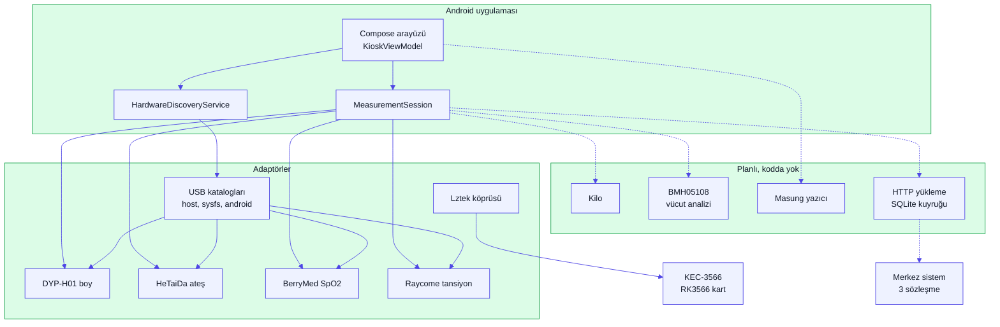

# Sağlık Kiosk — Genel Mimari (Hub)

> **Gizli/Confidential.** Bu wiki Sağlık Kiosk projesine ait iç bilgiler içerir. Yalnız yerel kullanım içindir; paylaşılmamalı, dışarı aktarılmamalıdır.

Bu sayfa **Hub-and-Spoke** düzeninin merkez düğümüdür: `wiki/saglik-kiosk/` altındaki her spoke sayfası breadcrumb ile buraya döner, bu sayfa da her spoke'a bağlanır. Kaynak: `raw/saglik-kiosk` (salt okunur).

## Genel Bakış

Proje (`tr.com.innova.saglikkiosk`, v0.1.0) Initium iskeletinden türetilmiş **endüstriyel Android sağlık kiosku prototipidir**: Kotlin + Jetpack Compose, minSdk 24, hexagonal mimari. Çalışan ölçüm turu dört USB cihazla yürür: **boy → ateş → SpO2 → tansiyon**. Kilo, 8 elektrotlu vücut analizi, termal yazıcı, HTTP yükleme ve SQLite kuyruğu henüz uygulanmamıştır. Tedarikçi belgeleri ve fizibilite raporu ise eski bir tasarımı (Lztek UART'a bağlı ASCII modüller) anlatır; bu fark wiki boyunca ana gözlemdir.

## Sistem Diyagramı

## Sayfalar

### Uygulama ve mimari

- [Sağlık Kiosk Uygulaması](saglik-kiosk-app.md) — teknoloji yığını, manifest, kiosk davranışı, paket yapısı.
- [Hexagonal Mimari ve Portlar](hexagonal-mimari.md) — katmanlar, port tablosu, belge–kod kayması, katman sızıntıları.
- [Ölçüm Oturumu](olcum-oturumu.md) — zaman aşımları, hata eşleme, kullanılmayan `runVitalTour`.
- [Kiosk Arayüz Akışı](kiosk-ui-akisi.md) — ekranlar, durum makinesi, tur kuralları.
- [Geliştirici Rehberi (C# / Qt için)](gelistirici-rehberi-cpp-qt.md) — kavram eşlemesi, dosya haritası, yeni cihaz ekleme, kayıt/telemetri/entegrasyon önerisi.
- [Figma Ekran Tasarımı](figma-ekran-tasarimi.md) — tedarikçinin tasarım dışa aktarımı; hedef ekran akışı ve uygulamayla fark.
- [Yönetim Paneli ve Ekran Koruyucu](admin-paneli-ve-ekran-koruyucu.md) — gizli PIN girişi, ayarlar, boşta video.

### Donanım ve cihaz sürücüleri

- [Donanım Keşfi ve USB](donanim-kesfi-ve-usb.md) — üç USB kataloğu, VID/PID rol haritası, sondalar, izin ve kök erişim.
- [DYP-H01 Boy](dyp-h01-boy.md)
- [HeTaiDa HTD8808C Ateş](hetaida-htd8808c-ates.md)
- [BerryMed YS2000A SpO2](berrymed-ys2000a-spo2.md)
- [Raycome RBP-7000 Tansiyon](raycome-rbp7000-tansiyon.md)
- [Lztek Anakart ve KEC-3566](lztek-anakart.md) — `sdkapi.jar`, kiosk modu, kullanılmayan API'ler.

### Protokoller ve entegrasyon

- [OEM ASCII Protokolü](oem-ascii-protokolu.md) — `#…$`/`M…$` komutları ve çözücüleri; gerçek turda kullanılmaz.
- [Veri Yükleme Arayüzleri](veri-yukleme-arayuzleri.md) — 1.0.4, Pre-job v1.2, Smart Health Cabin v1.15 ve örnek veri.
- [Faz 2: Yazıcı, Vücut Analizi, Yükleme](faz2-yazici-vucut-analizi-yukleme.md) — planlı kalemler.

### Karar, süreç ve referans

- [Fizibilite Raporu](fizibilite-raporu.md) — "yazılabilir" kararı, riskler, fazlar.
- [Geliştirme Süreci](gelistirme-sureci.md) — Initium, YZ iş akışı, CI.
- [Test Stratejisi](test-stratejisi.md) — birim test kapsamı ve boşluklar.
- [INBCA Ürün Kataloğu](inbca-urun-katalogu.md) — eklenen tedarikçi kataloğu.

## Çapraz Gözlemler

1. **Belge–kod kayması.** Fizibilite raporu, `overview.md` ve tedarikçi docx'leri Lztek UART + ASCII tasarımını anlatır; kod, VID/PID ile tanınan dört USB cihaza göre yazılmıştır ([Hexagonal Mimari](hexagonal-mimari.md), [OEM ASCII](oem-ascii-protokolu.md)).
2. **Kök yetkiye bağımlılık.** HID `hidraw` ve bazı tty düğümleri için `su 0` kullanılır; platform imzası/ROOT gereksinimi raporda da risk olarak geçer ([Donanım Keşfi](donanim-kesfi-ve-usb.md), [Lztek](lztek-anakart.md)).
3. **VID/PID rol çakışması riski.** Cihaz rolü yalnız USB kimliğinden çıkarılır; aynı çipli (CH340, FTDI) başka bir cihaz yanlış role eşlenebilir. Port–modül haritası belgelenmemiştir.
4. **Eksik ölçümler.** Kilo ve vücut analizi sürücüsü yok; BMI hep boş, yükleme şemalarındaki boy/kilo kaydı eksik kalır ([Ölçüm Oturumu](olcum-oturumu.md), [Veri Yükleme](veri-yukleme-arayuzleri.md)).
5. **`runVitalTour` kullanılmıyor.** Testli tur yolu ile arayüzün gerçekte izlediği yol ayrışıyor ([Test Stratejisi](test-stratejisi.md)).
6. **Üç yükleme sözleşmesi, hedef belirsiz.** 1.0.4, Pre-job v1.2 ve Smart Health Cabin v1.15'in hangisinin kullanılacağı kaynaklarda yok; hepsi 120 saatlik yeniden deneme kuralını paylaşır.
7. **Adlandırma.** Tedarikçi belgesi tansiyon modülüne `Cemho`, kod `Raycome` der; eşleşme çıkarımdır.
8. **Şablon kalıntıları.** `SECURITY.md` ve Jira ayarları doldurulmamış; derleme çıktıları depoda ([Geliştirme Süreci](gelistirme-sureci.md)).
9. **Tasarım vs uygulama.** Figma tasarımı vücut analizi, ödeme ve ölçek ekranlarını da içerir; uygulama yalnız dört vitali kapsar ([Figma](figma-ekran-tasarimi.md)).
10. **Rapor vs gerçek.** Rapor ölçüm doğruluğu, regülasyon ve KVKK'yı kapsam dışı/risk olarak işaretler; bunlar ayrı karar gerektirir ([Fizibilite Raporu](fizibilite-raporu.md)).
- [Yeni Sensör Kiti: Analiz ve Plan](yeni-sensor-kiti-analizi.md) — Dingheng kiti farkları, boşluklar, sunum adımları.
