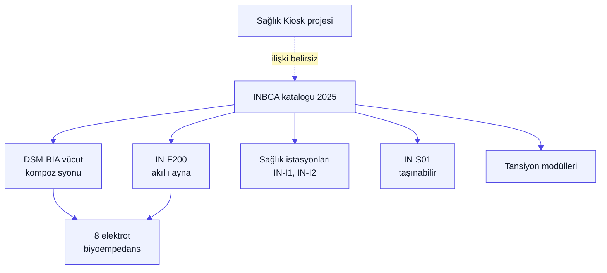

# INBCA Ürün Kataloğu (2025)

⬅ [Genel Mimari (Hub)](hub.md)

48 sayfalık, Haziran 2025 tarihli (PDF üst verisi) İngilizce tedarikçi kataloğu. Metin büyük oranda görsellerde olduğundan yalnız metin katmanı okunabildi; aşağıdakiler bu metne dayanır ve eksik olabilir. Katalog **bu projedeki kioskun spesifikasyonu değildir**; projeyle ilişkisi (aynı üretici/ürün ailesi) kaynaklarda yazılı değildir.

## İçerik

| Ürün | Öne çıkanlar (katalog metni) |
|------|-----------------------------|
| DSM-BIA profesyonel vücut kompozisyonu analizörü | 50'den fazla test verisiyle vücut modeli, IoT ve IAP uzak ağ geçidi teknolojisi, ziyaretçi ve üye modları, yüz tanıma/IC kart girişi, 10,1" dokunmatik LCD; örnek rapor (boy 182,1 cm, 87,8 kg, yağ oranı, kas, segment analizi) |
| IN-F200 | 32", 1920×1080, 450 cd/m²; **Rockchip RK3399**, 4 GB / 32 GB; Wi-Fi 2,4+5 GHz, BLE 5.0; 2 MP kamera; **Android 7.1** (isteğe bağlı 11); USB-A OTG ve HOST, RJ45; 8 Ω 5 W×2 hoparlör; ≤70 W; çalışma 0–60 °C. Sekiz elektrotlu biyoempedans + yapay zekâ/makine görüşü ile duruş, omurga ve kas durumu analizi; 3B dönen "ayna" ekranı |
| IN-I1 / IN-I2 sağlık istasyonları | Üye ve ziyaretçi ölçüm sayacı; tansiyon modülü (osilometrik + Korotkoff, 0–295 mmHg, ±3 mmHg, nabız 40–199/dk ±%5, manşet 24–42 cm) |
| IN-S01 | Tek parça bütünleşik tasarım, yerel elektronik sağlık kaydı, veri yükleme, nüfus sağlığı/kronik hastalık takibi, halk sağlığı taraması |
| Ek ürünler | Görme taraması, ağırlık sensörlü (paralel kiriş) ölçüm kolonları; birçok sayfada yalnız ambalaj bilgisi |

## Projeyle ilişki

- **Tansiyon**: katalogdaki osilometrik+Korotkoff tanımı, projede kullanılan Raycome RBP-7000 sınıfı modüllerle uyumlu bir kategoridir; model eşleşmesi doğrulanmadı ([Raycome RBP-7000](raycome-rbp7000-tansiyon.md)).
- **Vücut analizi**: sekiz elektrotlu biyoempedans, projedeki planlı BMH05108 modülünün ürün düzeyindeki karşılığı olabilir ([Faz 2](faz2-yazici-vucut-analizi-yukleme.md)).
- **Platform**: IN-F200'ün RK3399/Android 7.1 platformu, projedeki Lztek KEC-3566 (RK3566) kartından farklıdır ([Lztek Anakart](lztek-anakart.md)); proje `minSdk 24` ile Android 7.0+ hedeflediği için Android 7.1 ile uyumludur.
- Cihazlardaki "ziyaretçi/üye", yüz/IC kart girişi ve veri yükleme özellikleri, Faz 3 kimlik kapsamıyla ve [Veri Yükleme Arayüzleri](veri-yukleme-arayuzleri.md) ile örtüşür.

## İlgili

- [Fizibilite Raporu](fizibilite-raporu.md)
