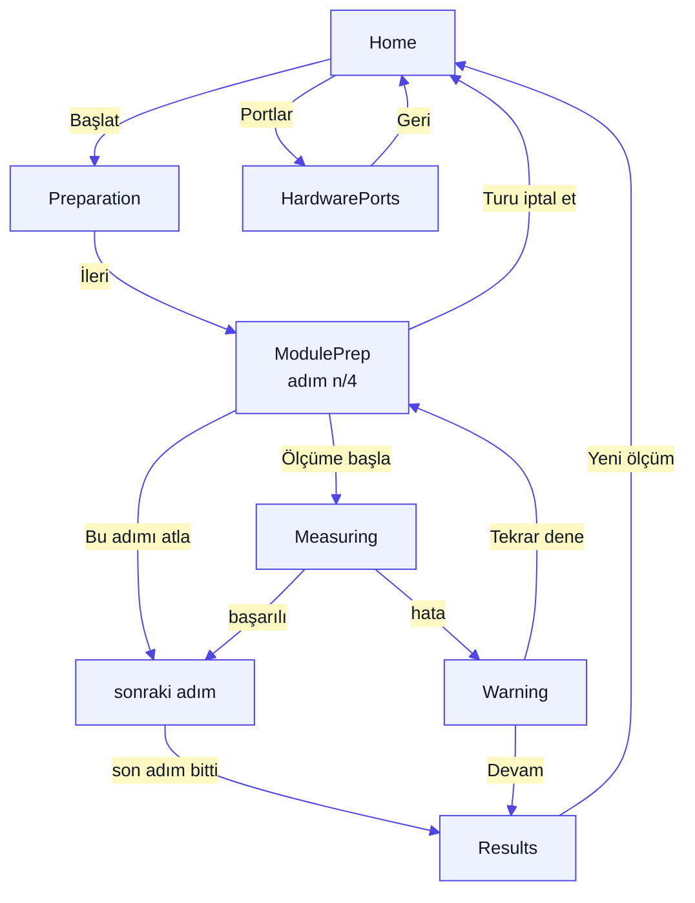

# Kiosk UI Akışı ve Durum Makinesi

⬅ [Genel Mimari (Hub)](hub.md)

Arayüz tek `MainActivity` içinde Jetpack Compose ile çizilir. `KioskApp` tek bir `KioskUiState` akışını (`StateFlow`) dinler ve `KioskScreen` değerine göre ekran seçer. Ekran adları ve yorumlar bir Figma tasarımına atıf yapar ("Figma üst seviye frame"); tasarım dosyası olarak `docs/vendor/` altında bir `.fig` dosyası da bulunur (adı bozuk karakterlidir; içeriği okunmadı).

## Akış

## Ekranlar

| `KioskScreen` | Composable | İşlev |
|---------------|-----------|-------|
| `Home` | `HomeFrame` | Karşılama, donanım bandı ("Bağlı: Boy:… · …" ya da mock/bilinmiyor uyarısı), 6 modül simgesi (Boy, Ateş, Tansiyon, SpO2, Nabız, Vücut analizi), **Portlar** ve **Başlat** düğmeleri |
| `HardwarePorts` | `HardwarePortsFrame` | Aday seri portlar, USB cihaz listesi, modül bağlantı durumu, "Tüm modülleri tara" ([Donanım Keşfi ve USB](donanim-kesfi-ve-usb.md)) |
| `Preparation` | `PreparationFrame` | Genel hazırlık metni; eksik cihaz atlanabilir uyarısı |
| `ModulePrep` | `ModulePrepFrame` | Sıradaki cihaz için kontrol listesi, "algılandı/algılanmadı" bandı, Ölçüme başla / Atla / Turu iptal et / Port listesini yenile |
| `Measuring` | `MeasuringFrame` | Canlı boy (cm), SpO2 pleth dalgası, durum metni |
| `Warning` | `WarningFrame` | Hata kartı; Tekrar dene ve Devam |
| `Results` | `ResultsFrame` | Metrik kartları, BMI kutusu (varsa) ve BMI göstergesi, yasal uyarı metni |

Home ekranındaki altı modül simgesi tıklanabilir değildir (alt başlık "bir modül seçin veya tüm turu başlatın" dese de tur yalnız **Başlat** ile başlar). "Nabız" ve "Vücut analizi" simgeleri görseldir; vücut analizi için sürücü yoktur ([Faz 2 Kapsamı](faz2-yazici-vucut-analizi-yukleme.md)).

## Durum (`KioskUiState`)

Başlıca alanlar: `screen`, `busy`, `status`, `activeModule`, `liveHeightCm`, `liveSpo2Percent`, `livePulseBpm`, `spo2Waveform`, `results`, `bmi`, `error`, `inventory`, `portScanBusy`, `scanningModule`, `scanningPortPath`, `usingMockHardware`, `usbHostAvailable`, `tourSteps`, `tourStepIndex`, `currentModuleDetected`.

## Tur kuralları (`KioskViewModel`)

- `startTour()`: sonuçları sıfırlar, `tourSteps = TourModuleOrder.STEPS` (boy → ateş → SpO2 → tansiyon), `ModulePrep`'e geçer ve port listesini yeniler.
- Algılama (`detectCurrentModule`): mock donanımda daima `true`; gerçekte `AttachedEtcSensors.presentModules(usbDevices)` içinde mevcut modül varsa `true`. Algılanmasa da kullanıcı "Ölçüme başla" diyebilir (düğme engellenmez).
- `confirmModuleReadyAndMeasure()`: `Measuring`'e geçer, her adımda **yeni bir** `MeasurementSession` kurar ve `measureModule(module)` çağırır. Canlı ilerleme `applyProgress` ile duruma işlenir.
- SpO2 kilitlenince sonuç eklenir, ekran 2,5 sn (`SPO2_LOCK_HOLD_MS`) kilitli değeri gösterir, sonra ilerler. Dalga formu en çok 96 nokta tutar (`WAVEFORM_POINTS`).
- Başarısızlıkta `Warning` açılır; `retryFromWarning()` aynı adımın `ModulePrep`'ine döner. **Devam** (`dismissWarningToResults`) kalan adımları atlayıp doğrudan sonuçlara gider; sonuç yoksa yine `Warning` ("en az bir cihaz ölçülmeli").
- `skipCurrentModule()` bir sonraki adıma geçer; tüm adımlar atlanırsa sonuç boştur ve `Warning` açılır.
- BMI yalnız boy **ve** kilo sonucu varsa hesaplanır; kilo ölçülmediğinden BMI göstergesi şu an hep boş kalır (`BmiGauge` BMI sınırlarını 18,5 / 25 / 30 olarak çizer).
- `goHome()` tüm geçici durumu temizler.

## Metinler ve ürün dili

Tüm metinler `res/values/strings.xml` içinde Türkçedir. Sonuç ekranı "Sonuçlar bilgilendirme amaçlıdır; klinik tanı değildir." uyarısını gösterir; proje kuralı klinik tanı iddiası yasağıdır ([Geliştirme Süreci](gelistirme-sureci.md)). Raycome için hazırlık metni cihazın açık olması gerektiğini ve tamamen kapalıysa manşonun şişmeyeceğini belirtir.

## İlgili

- [Ölçüm Oturumu](olcum-oturumu.md)
- [Sağlık Kiosk Uygulaması](saglik-kiosk-app.md)
