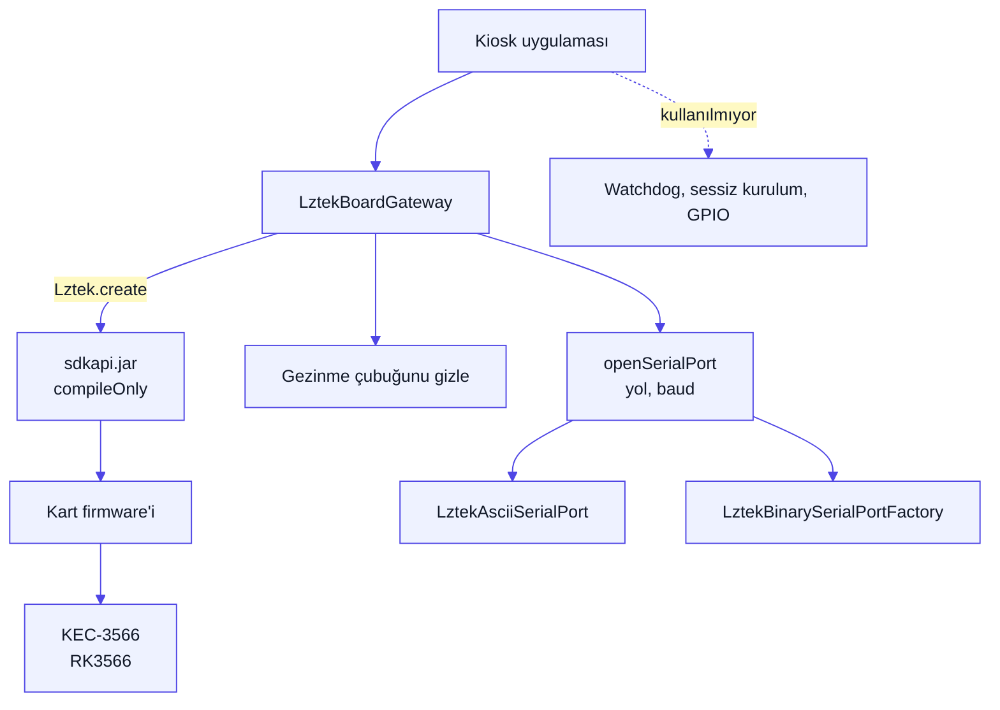

# Lztek Anakart, `sdkapi.jar` ve KEC-3566

⬅ [Genel Mimari (Hub)](hub.md)

> **Düzeltme (2026-11-23):** Sahaya gelen kutu **RK3576** tabanlı (cihaz ayarlarında model `rk3576_u`): 4× Cortex-A72 2,2 GHz + 4× Cortex-A53 1,8 GHz, Mali-G52 MC3, 6 TOPS NPU, 8K/4K donanım video çözme. Arka/ön panel: 2× RS232 (COM0/COM1), 2× LAN, 4–5 USB (biri USB 3.0), HDMI, TF, Micro SIM + 4G anten, DC 12V. Aşağıdaki KEC-3566 (RK3566) bilgileri `etc/android-pc` belgelerinden gelir ve sahadaki kutuyu tam yansıtmaz. RAM/depolama/Android sürümü admin → Sistem Bilgisi'nden okunabilir.

Proje belgelerinde hedef donanım "Lztek endüstriyel Android anakart" olarak geçer ([Fizibilite Raporu](fizibilite-raporu.md)). `etc/android-pc/KEC-3566/` klasörü bu anakarta ait belgeleri ve SDK'yı içerir. Kod yorumları (`HidrawInterruptPort`, `SysfsUsbDeviceCatalog`) "rk3566" için Rockchip davranışını anar; bu, KEC-3566 ile aynı SoC ailesidir. **Sahadaki kartın kesin modeli kaynaklarda açıkça yazılmamıştır**; KEC-3566 ile eşleştirme bu klasörün varlığına dayalı çıkarımdır.

## Donanım (KEC-3566 teknik şartnamesi V1.0, 2022-02-18)

| Özellik | Değer |
|---------|-------|
| SoC | Rockchip RK3566, 4× Cortex-A55, en çok 1,8 GHz; Mali-G52 GPU; NPU ~1 TOPS |
| Bellek | Standart 2 GB LPDDR4 (4/8 GB seçenek); 16 GB flash (en çok 128 GB) |
| Arayüzler | 5× USB 2.0 + 1× USB 3.0, 1× microUSB OTG, **2× RS232** (2× RS485 seçenek), Gigabit Ethernet, HDMI 2.0, Wi-Fi/BT 5.2, TF kart, isteğe bağlı 4G |
| İşletim sistemi | Android 11 önerilir; Linux seçenekleri de var |
| Güç / ortam | 9–15 V DC; çalışma −20…70 °C |
| Diğer | RTC, zamanlı açma/kapama, yerel USB yükseltme, yanıp sönen/yazılım "burn" tuşu |

İkinci belge `K-3566 Motherboard Spec 20230726.pdf` bu çalışmada okunamadı (dosya adı farklı biçimde geçtiği için açılamadı); içeriği bu sayfaya yansımamıştır.

## SDK (`sdkapi.jar`, API kılavuzu V1.1 — 2021-12-26)

- Tüm API'ler `com.lztek.toolkit.Lztek` nesnesi üzerinden çağrılır; proje jar'ı `compileOnly` ekler (kılavuz Android 3.0+ için bunu önerir). Sınıflar **cihaz firmware'inde** bulunur; emülatörde/standart telefonda yoktur.
- Sürüm notu: `V1.2.0.20211022` ile birçok API için **ROOT gerekmez**; ancak GPIO, watchdog, güç işlemleri, sessiz uygulama kurulumu ve kabuk komutu API'leri kılavuzda hâlâ "root gerektirir" olarak işaretlidir. Platform imzası gerekiyorsa üreticinin imza sunucusu önerilir.
- Seri port: `openSerialPort(path, baudrate)` döndürdüğü `SerialPort`'tan `getInputStream`/`getOutputStream` alınır; kapanınca akışlar da kapanır. Basit sürüm yalnız yol ve baud ayarlar (veri biti 8, eşlik yok, akış kontrolü yok).
- Diğer bölümler: ağ/Ethernet, depolama, RAM, ekran ışığı, sistem saati, GPIO, donanım watchdog, kapat/yeniden başlat/RTC alarm, HDMI-IN, ekran çözünürlüğü/yakalama/döndürme/yoğunluk, gezinme ve durum çubuğu, uygulama yönetimi, sistem bilgisi, OTA, kabuk komutu.
- `etc/android-pc/KEC-3566/sdkapi-v20201022-r20230510/` içinde ayrıca `sdkdemo.apk` + `src/sdkdemo.zip` (anakart özelliklerini deneyen test uygulaması; sağlık uygulaması **değildir**), "Testing Guide" PDF'i ve `root/rooted-44|51|60_32|60_64|71.zip` paketleri bulunur. Bu paketlerin içeriği incelenmedi; adlandırma Android sürümlerine işaret ediyor olabilir (doğrulanmadı).

## Projede kullanılan kısım

| Kullanım | Sınıf | Davranış |
|----------|-------|----------|
| Kart algılama | `LztekBoardGatewayImpl.detectBoard()` | `Lztek.create(context)` istisna atmazsa kart vardır |
| Kiosk modu | `enterKioskModeOrIgnore()` | `hideNavigationBar()`; kart yoksa/istisnada sessizce atlar |
| Seri açma (ikili) | `LztekBinarySerialPortFactory` | `openSerialPort(path, baud)` → `StreamBinarySerialPort`; `null` dönerse `"Seri port açılamadı"` |
| Seri açma (ASCII) | `LztekSerialPortFactory` / `LztekAsciiSerialPort` | `$` bitiş işaretine kadar okur, varsayılan 1,5 sn (kapıda 1 sn) zaman aşımı |
| Port listesi | `serialPortCatalog()` | Kart varsa `FilesystemSerialPortCatalog`, yoksa mock |

Güncel etc cihazlarının hiçbiri Lztek yerel UART'ını kullanmaz: hepsi USB-UART/HID'dir. Lztek yolu yalnız `/dev/tty*` yollarında son çare ("native") olarak kalır ([Donanım Keşfi](donanim-kesfi-ve-usb.md)); ASCII yığını da çalışan turda yoktur ([OEM ASCII Protokolü](oem-ascii-protokolu.md)).

## Kullanılmayanlar (kodda arama sonucu)

Hardware watchdog, sessiz uygulama kurulumu ve GPIO için kodda **hiçbir çağrı yoktur**. `docs/architecture/overview.md` "Monitoring: Watchdog (Lztek)" ve "Deployment: APK, sessiz kurulum" der; bunlar plan aşamasındadır. Otomatik açılış şu an yalnız `HOME` intent filtresi ve `BootCompletedReceiver` ile sağlanır ([Sağlık Kiosk Uygulaması](saglik-kiosk-app.md)).

## İlgili

- [Hexagonal Mimari ve Portlar](hexagonal-mimari.md)
- [Fizibilite Raporu](fizibilite-raporu.md)
