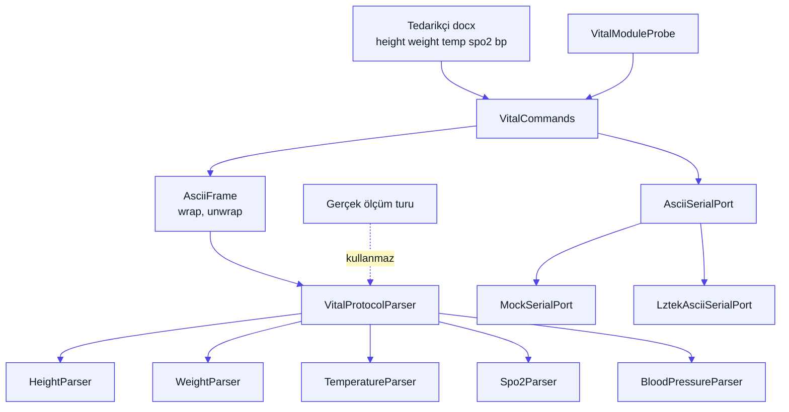

# OEM ASCII Protokolü (`#…$` ve `M…$`)

⬅ [Genel Mimari (Hub)](hub.md)

Tedarikçi paketindeki `Android … protocol.docx` belgeleri, modüllerin **4800 baud, ASCII** çerçevelerle konuştuğunu anlatır. Kod tabanı bu protokolün komutlarını ve çözücülerini tutar, ancak **çalışan ölçüm turu artık bu yığını kullanmaz**: tur, dört USB "etc" cihazının kendi protokollerini konuşan sürücülerle yürür ([Hexagonal Mimari](hexagonal-mimari.md)). Bu sayfa eski/OEM yığınını ve neden hâlâ önemli olduğunu özetler.

## Çerçeve kuralları

| Kural | Değer |
|-------|-------|
| Baud | 4800 (`VitalCommands.VITAL_BAUD_RATE`) |
| Başlangıç / bitiş | `#` … `$`; **boy** istisna: `M` … `$` |
| El sıkışma | `xL0$` → `xL1$` (`S` kilo, `T` ateş, `X` SpO2, `B` tansiyon) |
| `AsciiFrame.unwrap` | Boşluk kırpar, en az 3 karakter ister, `#…$` ya da `M…$` kabul eder |

## Komutlar (`VitalCommands`)

| Modül | Komutlar |
|-------|----------|
| Boy | `MS` + işaret + 2 hane ortam sıcaklığı + `$` (`heightStart`, varsayılan 25 °C, −99…99 sıkıştırılır); durdurma `MT$` |
| Kilo | el sıkışma `#SL0$`, kg modu `#SWA1$`, başlat `#SM1$`, durdur `#SM0$`, kilitli değeri onayla `#SOK$` |
| Ateş | `#TL0$`; uyandırma `#TMN$`, **2 sn bekle**, sonra `#TM0$` |
| SpO2 | `#XL0$`, `#XM0$` |
| Tansiyon | `#BL0$`, başlat `#BM0$`, durdur `#BM1$` |

Belgedeki diğer davranışlar: boy formülü `223,5 − ölçülen − kalibrasyon` ve anormal değer `M0000$`; kilo için kilitli değerin her saniye tekrarlanması, tara okuma/güncelleme (`#SP$`, `#SUP$`), sensör modeli (`#SS0$`/`#SS1$` → 200/500 kg) ve "terazide biri var" (`#SHM$`/`#SNM$`); SpO2 çıktısında `C` başarılı / `E` hata; tansiyonda 15'ten fazla hata kodu, Panasonic modülün anlık şişirme basıncı gönderip Omron'un göndermemesi.

## Kodda neler var

- **Çözücüler** (`domain/`): `HeightParser`, `WeightParser`, `TemperatureParser`, `Spo2Parser`, `BloodPressureParser`; hepsi `VitalProtocolParser.parse(module, frame)` üzerinden yönlendirilir. Sonuç `ParseResult` (ölçüm, ilerleme/önizleme ya da hata) olur; tansiyon hata kodları Türkçe metne eşlenir (`BloodPressureErrorCodes`).
- **Port** (`AsciiSerialPort`): ASCII çerçeve okuma/yazma; gerçeği `LztekAsciiSerialPort` (`$` görene dek, 1,5 sn varsayılan), sahtesi `MockSerialPort`.
- **Sonda** (`VitalModuleProbe`): el sıkışma komutlarıyla modül varlığını yoklar; yalnız `SerialPortCatalog` yolu bu yığını kullanır ([Donanım Keşfi ve USB](donanim-kesfi-ve-usb.md)).
- **Testler**: `VitalProtocolParserTest` satıcı örneklerini kullanır (ör. boy `parsesVendorHeightExampleWithDot`, kilo `parsesVendorLockedWeightExample`, tansiyon örneği kesik durum alanıyla). Ayrıntı: [Test Stratejisi](test-stratejisi.md).

## Gerçek turla ilişki ve boşluklar

- Çalışan turda **kilo yoktur** (sürücü yazılmamış); kilo çözücüsü ve komutları yalnız birim testte ve ASCII yolunda yaşar. Bu yüzden BMI sonuçta hep boştur ([Ölçüm Oturumu](olcum-oturumu.md)).
- Dört güncel cihazın protokolleri ASCII değildir: DYP-H01 ikili, HeTaiDa HID rapor, BerryMed BCI, Raycome V1.3 ([DYP-H01](dyp-h01-boy.md), [HeTaiDa](hetaida-htd8808c-ates.md), [BerryMed](berrymed-ys2000a-spo2.md), [Raycome](raycome-rbp7000-tansiyon.md)). Tedarikçi belgesindeki `Cemho` adı ile kodun `Raycome` adı aynı tansiyon modülünün farklı anılışı gibi görünür; bire bir eşleştirme kaynaklarda açıkça yazılı değildir.
- `docs/architecture/overview.md` hâlâ OEM ASCII yığınını anlatır; belge–kod kayması tablosu [Hexagonal Mimari](hexagonal-mimari.md) sayfasındadır.

## İlgili

- [Lztek Anakart](lztek-anakart.md)
- [Fizibilite Raporu](fizibilite-raporu.md)
