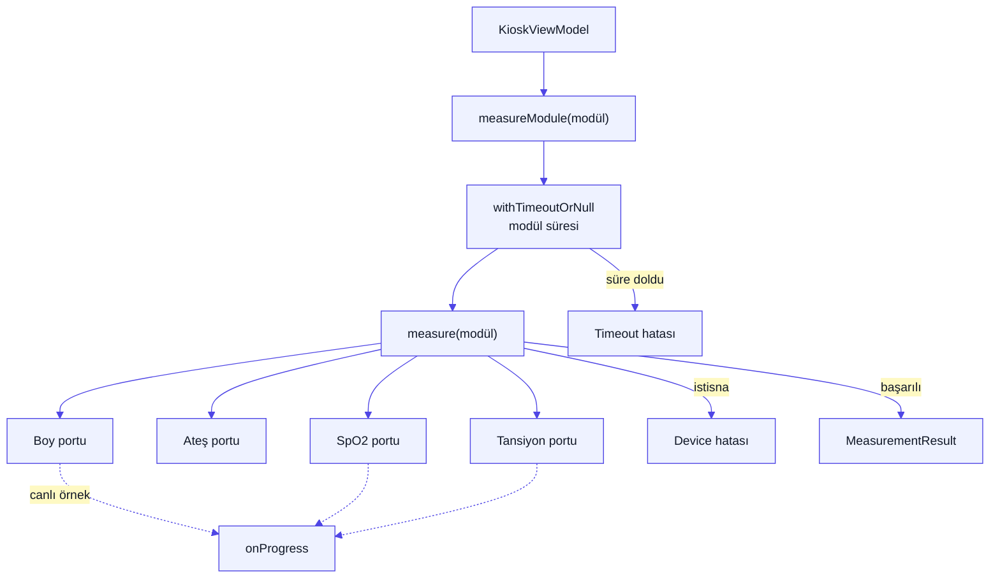

# Ölçüm Oturumu (`MeasurementSession`)

⬅ [Genel Mimari (Hub)](hub.md)

`MeasurementSession` dört sensör portunu (`HeightSensorPort`, `TemperatureSensorPort`, `Spo2SensorPort`, `BloodPressureSensorPort`) ve bir `onProgress` geri çağrısını alır; ölçümü modül başına zaman aşımıyla çalıştırır.

## Zaman aşımları

| Modül | Süre | Not |
|-------|------|-----|
| Boy | 15 sn | DYP adaptörü kendi içinde 12 sn akış okur |
| Ateş | 30 sn | |
| SpO2 | 75 sn | BerryMed adaptörünün azami süresiyle aynı |
| Tansiyon | 200 sn | Adaptör 180 sn; oturum pay bırakır |
| Kilo | 15 sn (yer tutucu) | `measure` bu modülde `error("Kilo modülü henüz yok")` fırlatır |

## Davranış

- `measureModule(module)`: süre dolarsa `MeasurementError.Timeout(module)`; adaptör istisna atarsa **tek tip** `MeasurementError.Device(code = module.name, message = istisna mesajı ya da "<modül> hatası")`. Hata `MeasurementException` içinde `Result.failure` olarak döner. Yani adaptörün ürettiği `error(...)` mesajları (ör. "Tansiyon cihazından seri yanıt yok…") doğrudan kullanıcıya gösterilen metindir.
- `runVitalTour(enabledModules)`: `TourModuleOrder.STEPS` sırasında (boy → ateş → SpO2 → tansiyon) ölçer; etkin olmayan modül için `TourProgress.Skipped` bildirir; ilk hatada `TourOutcome.Failed(error, partial)` döner. `enabledModules` boş kümeyse hiç ölçmeden "Takılı ölçüm cihazı yok" ile başarısız olur. Hiç okuma yoksa yine `Failed`.
- BMI: yalnız listede hem `Height` hem `Weight` varsa `BodyMassIndex.from(kg, cm)`; kilo modülü olmadığından **güncel turda BMI daima `null`**.
- Canlı ilerleme olayları `TourProgress`: `Step`, `Skipped`, `LiveHeight(cm)`, `LiveSpo2(spo2, nabız, pleth)`, `LiveBloodPressure(mesaj, …)`.

## Gözlem: `runVitalTour` kullanılmıyor

Üretim akışında `KioskViewModel` turu kendisi yönetir: her adım için `sessionFactory{…}.measureModule(module)` çağırır, sonuçları biriktirir ve BMI'yi `finishTourWithResults` içinde ayrıca hesaplar. `runVitalTour` yalnız `MeasurementSessionTest` tarafından çağrılır; BMI mantığı iki yerde yinelenir. Bkz. [Kiosk UI Akışı](kiosk-ui-akisi.md).

## Sonuç türleri (`MeasurementResult`)

`Height(cm)`, `Weight(kg, locked)`, `Temperature(°C)`, `Spo2(%, locked)`, `BloodPressure(sistol, diyastol, nabız, statusCode)`. Raycome yolunda `statusCode = "OK"`; OEM ASCII yolunda iki haneli Cemho kodu (`"00"` başarı) kullanılır ([OEM ASCII Protokolü](oem-ascii-protokolu.md)).

## İlgili

- [Hexagonal Mimari ve Portlar](hexagonal-mimari.md)
- [DYP-H01 Boy Sensörü](dyp-h01-boy.md) · [HeTaiDa Ateş](hetaida-htd8808c-ates.md) · [BerryMed SpO2](berrymed-ys2000a-spo2.md) · [Raycome Tansiyon](raycome-rbp7000-tansiyon.md)

> **Güncelleme (2026-11-23):** Tansiyon oturum zaman aşımı 200 sn → **120 sn** (ziyaretçi bırakıp giderse kiosk 3+ dk beklemesin). Süreler artık `MeasurementSession.timeoutMsFor(module)` ile dışarı açık; ölçüm ekranındaki geri sayım bunu kullanır.
