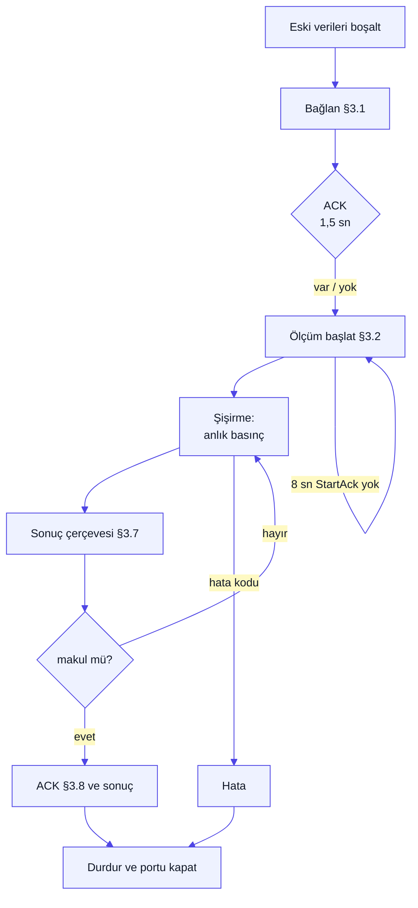

# Raycome RBP-7000 Tansiyon Cihazı

⬅ [Genel Mimari (Hub)](hub.md)

Tur sırasındaki **son** ve en uzun adımdır (azami 200 sn). Protokol belgesi: `etc/blood-pressure/RBP-7000 communication protocol(V1.3_20201119).pdf`; kod bölümleri §3.1–§3.8 ve §5.1–§5.2 olarak anar. Not: eski proje dokümanları tansiyon üreticisini "Cemho" diye anar; kod ve cihaz Raycome'dur ([OEM ASCII Protokolü](oem-ascii-protokolu.md)).

## Bağlantı

| Özellik | Değer |
|---------|-------|
| USB | FTDI FT232R `0403:6001`; Linux'ta `ftdi_sio` → `ttyUSB0` (`etc/blood-pressure/android-log.txt`) |
| Seri | **9600 8N1**; rol `BLOOD_PRESSURE_RAYCOME` |
| DTR/RTS | Cihaz host komutunu görmesi için DTR+RTS'in yükselmesi gerekir; bu yüzden önce `UsbSerial` yolu denenir ([Donanım Keşfi](donanim-kesfi-ve-usb.md)) |

## Paket biçimi

`[ön ek 2B] [sürüm=03] [uzunluk] [tip] [alt kod] [veri…] [CKS]`

- Ön ek: host → cihaz `CC 80`, cihaz → host `AA 80`.
- `uzunluk` = tip + alt kod + veri bayt sayısı. Çerçeve toplamı = 2 + 1 + 1 + uzunluk + 1.
- `CKS` = ön ek ve CKS hariç tüm baytların XOR'u.
- Örnek (başlat): `CC 80 03 03 01 02 00 03` (hazırlık metninde de geçer).

| İşlem | Tip/alt kod | Paket |
|-------|-------------|-------|
| Bağlan (§3.1) | `01/01` | `connect()` |
| Ölçüm başlat (§3.2) | `01/02` | `startMeasurement()` |
| Ölçüm durdur (§3.3) | `01/03` | `stopMeasurement()` |
| Sonuç ACK (§3.8) | `01/06` | `ackMeasurementResult()` |
| Cihaz kodu sorgusu (§5.1) | `03/01` | `queryDeviceInfo()` |
| Cihaz saati (§5.2) | `03/02`–`03/03` | yanıt `Rtc` |

Gelen çerçeveler: `ConnectAck` (01/01), `StartAck` (01/02), `StopAck` (01/03), `RealtimePressure` (01/05, 16 bit BE mmHg), `Measurement` (01/06), `Error` (01/07), `DeviceInfo` (03/01), diğerleri `Other`. Sağlaması tutmayan çerçeve bütünüyle atılır; ön ek olmayan baytlar tek tek atlanarak yeniden senkronlanır (arabellekli ayrıştırıcı).

**Ölçüm çerçevesi** (01/06): veri ≥ 13 bayt ise son 6 bayt sistol, diyastol, nabız (her biri 16 bit big-endian); `data[0]` kullanıcı bayrağıdır. Çoklu yükleme modunda barkod içeren daha uzun biçim (FUN2) kodda ayrıca çözülmez.

**Makul okuma süzgeci** (`isPlausibleFinalReading`): sistol 70–250, diyastol 40–160, sistol > diyastol, nabız 30–200 mmHg/dk; aksi halde "Ara değer" sayılıp beklenir (`raycomeRejectsImplausibleEarlyPressure`).

## Hata kodları (Tablo 2)

| Kod | Anlam (Türkçe metin) |
|-----|----------------------|
| `0x01` | Basınç koruması |
| `0x02` | Üst kese / sinyal hatası — yeniden ölçün |
| `0x05` | Alt kese / sinyal hatası — yeniden ölçün |
| `0x06` | Sensör / sinyal hatası — yeniden ölçün |
| `0x09` | Anormal sönme |
| `0x0F` | Sistem hava kaçağı |
| `0x10` | Motor hatası |
| diğer | `Bilinmeyen hata 0x..` |

## Adaptör akışı (`RaycomeBloodPressureAdapter`)

1. Okunmamış eski baytları boşaltır (en çok 8 okuma).
2. Bağlan gönderir; 1,5 sn içinde `ConnectAck`/`DeviceInfo` bekler. ACK gelmese de başlat gönderilir (durum metni uyarır).
3. Başlat gönderir. `StartAck` gelmezse **8 sn'de bir** yeniden gönderir.
4. 12 sn boyunca hiçbir çerçeve gelmezse `"Tansiyon cihazından seri yanıt yok…"` hatası (cihaz kapalı olabilir veya FTDI takılı değildir).
5. Her 3 sn'de durum metni üretir ("Manşon şişiyor / ölçülüyor… (~Ns)"), anlık basıncı gösterir.
6. Makul sonuçta ACK gönderir ve `BloodPressure(sistol, diyastol, nabız, "OK")` döner; `Error` çerçevesi hata fırlatır.
7. `finally` bloğu her durumda **durdur** paketi gönderir ve portu kapatır. Azami süre 180 sn.

## FTDI sürücü çakışması

Çekirdek `ftdi_sio` portu tutarken `usbfs` erişimi kilitlenir. `CompositeBinarySerialPortFactory.openRaycome` önce `ftdi_sio`'yu bırakır (`su 0`, unbind), `UsbSerial` ile açmayı dener (DTR/RTS); olmazsa `usbfs`→`ftdi_sio` bind ederek tty yoluna düşer. Bu iki adım **kök yetkisi** ister.

## Mock ve test

`MockRaycomeBloodPressureAdapter` 120/75, nabız 72 döndürür. Keşif mock'u bağlan/cihaz bilgisi/başlat isteklerine `AA 80` çerçeveleriyle yanıt verir (başlatta ACK + 120/80, nabız 75 ölçümü). Testler: `raycomeParsesFun1MeasurementFrame`, `raycomeStartAckIsNotMeasurement`, `raycomeParsesErrorFrame`, `raycomeRejectsImplausibleEarlyPressure`, `raycomeControlPacketsMatchV13`, `raycomeQueryDeviceInfoBuildsHostPacket` ([Test Stratejisi](test-stratejisi.md)).

`etc/blood-pressure/python/raycome-rbp7000.pyw`: PyQt6 test aracı; `RBP-7000 Series.pdf` cihaz broşürü.

## İlgili

- [Donanım Keşfi ve USB](donanim-kesfi-ve-usb.md)
- [OEM ASCII Protokolü](oem-ascii-protokolu.md) (eski Cemho `#B…$` dili ve hata tablosu)
- [Ölçüm Oturumu](olcum-oturumu.md)
