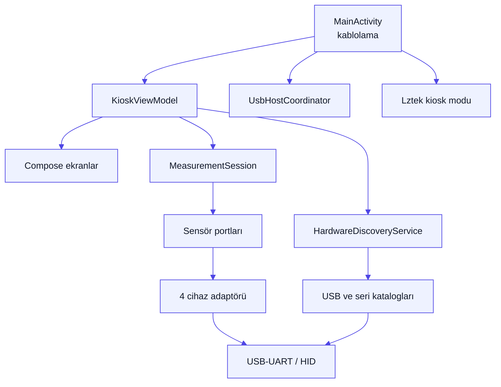

# Sağlık Kiosk Android Uygulaması

⬅ [Genel Mimari (Hub)](hub.md)

Uygulama kimliği `tr.com.innova.saglikkiosk`, sürüm `0.1.0` (`versionCode 1`). Proje bir **prototip/iskelet** aşamasındadır (`docs/context/project-brief.md`: "Prototip / iskelet"). Ziyaretçi ekrandan bir ölçüm turu başlatır; uygulama takılı USB sensörleri bulur, sırayla ölçer ve özet gösterir. Sonuçlar bilgilendirme amaçlıdır, klinik tanı değildir (`disclaimer_short` metni).

## Mimari



Katman ayrıntıları için [Hexagonal Mimari](hexagonal-mimari.md), ekran akışı için [Kiosk UI Akışı](kiosk-ui-akisi.md) sayfalarına bakın.

## Teknoloji ve derleme

| Alan | Değer | Kaynak |
|------|-------|--------|
| Dil / JVM | Kotlin 2.0.21, JVM hedefi 17 | `build.gradle.kts`, `app/build.gradle.kts` |
| Android | `minSdk 24`, `targetSdk`/`compileSdk 35` | `app/build.gradle.kts` |
| Derleme | AGP 8.7.2, Gradle 8.11.1 | `build.gradle.kts`, `gradle-wrapper.properties` |
| UI | Jetpack Compose (BOM 2024.10.01), Material 3, ViewModel + StateFlow | `app/build.gradle.kts` |
| Asenkron | `kotlinx-coroutines-android` 1.9.0 | `app/build.gradle.kts` |
| USB-seri | `com.github.mik3y:usb-serial-for-android:3.8.1` (JitPack üzerinden) | `settings.gradle.kts` |
| Anakart SDK | `libs/sdkapi.jar`, **compileOnly** | [Lztek Anakart](lztek-anakart.md) |
| Test | JUnit 4.13.2, `kotlinx-coroutines-test` | [Test Stratejisi](test-stratejisi.md) |

Komutlar (`CLAUDE.md`): `./gradlew :app:assembleDebug`, `./gradlew test`, `./gradlew lint`, `./gradlew :app:assembleRelease`. Release derlemesinde `isMinifyEnabled = false`.

> Not: `docs/context/tech-stack.md` MockK, OkHttp ve SQLite'ı listeler; `app/build.gradle.kts` içinde bu bağımlılıkların hiçbiri **yoktur** (bkz. [Hexagonal Mimari](hexagonal-mimari.md) → Doküman–kod farkları).

## Manifest ve kiosk davranışı

- İzinler: `INTERNET`, `RECEIVE_BOOT_COMPLETED`. `android.hardware.usb.host` özelliği `required="false"`. `allowBackup="false"`.
- `MainActivity`: dikey (`portrait`), `singleTask`. Hem **LAUNCHER** hem **HOME/DEFAULT** intent filtresi var; cihazda varsayılan ana ekran seçilirse açılışta otomatik gelir.
- `USB_DEVICE_ATTACHED` filtresi `res/xml/usb_device_filter.xml` ile bağlı: HeTaiDa `0C45:7702`, CH340 `1A86:7523`, FTDI `0403:6001`, Cypress `04B4:0008` ve `04B4:B71D` (dosyada ondalık yazılmıştır).
- `BootCompletedReceiver` (`directBootAware`): `BOOT_COMPLETED`, `LOCKED_BOOT_COMPLETED`, `QUICKBOOT_POWERON` (iki varyant) olaylarında `MainActivity`'yi `NEW_TASK | CLEAR_TOP | SINGLE_TOP` ile başlatır. Kaynak yorumu: HOME launcher olarak kayıtlıysa sistem zaten açar, bu alıcı yedek yoldur.
- `onCreate`: `enableEdgeToEdge()`, ardından `boardGateway.enterKioskModeOrIgnore()` (Lztek varsa gezinme çubuğunu gizler, yoksa sessizce atlar).

## Açılış kablolaması (`MainActivity`)

`MainActivity` iki bayrak hesaplar: `hasUsbHost` (`FEATURE_USB_HOST`) ve `lztekAvailable` (`Lztek.create(context)` istisna atmıyor mu).

`usingMockHardware = !hasUsbHost && !lztekAvailable`. Yani **tablet + OTG** gibi Lztek'siz ama USB Host'lu bir cihazda da gerçek donanım yolu seçilir.

| Bileşen | Mock donanım | Gerçek donanım |
|---------|--------------|----------------|
| USB kataloğu | Gerçek katalog boşsa `MockUsbDeviceCatalog` | `AndroidUsbDeviceCatalog` + `SysfsUsbDeviceCatalog` + `FilesystemUsbBusCatalog` birleşimi |
| İkili port fabrikası | `MockBinarySerialPortFactory` | `CompositeBinarySerialPortFactory` (tty / UsbSerial / Lztek native) |
| Seri katalog | `MockSerialPortCatalog` | Lztek varsa `UsbHostSerialPortCatalog` + `FilesystemSerialPortCatalog`; yoksa yalnız USB Host kataloğu |
| Sensör paketi | `SensorAdapterFactory.mockSuite()` | `SensorAdapterFactory.boardSuite(...)`, yollar `usb-role:*` belirteçleri |

ViewModel fabrikası kurulurken istisna olursa uygulama çökmek yerine **mock ViewModel fabrikasına** düşer (`mockViewModelFactory`). `UsbHostCoordinator` açılışta başlatılır, USB takma/çıkarma ve izin olaylarında `kioskViewModel.refreshPorts()` çağırır.

Ayrıntılar: [Donanım Keşfi ve USB](donanim-kesfi-ve-usb.md).

## Paket yapısı

```
tr/com/innova/saglikkiosk/
  domain/            ölçüm türleri, ayrıştırıcılar, cihaz protokolleri (Android bağımlılığı yok)
  domain/device/     DYP-H01, BerryMed, Raycome, HeTaiDa protokolleri, USB rol haritası
  application/       MeasurementSession, HardwareDiscoveryService, port arayüzleri
  adapter/           dyp, berrymed, raycome, hetaida, lztek, serial, usb, SensorAdapterFactory
  ui/                KioskViewModel, KioskApp, screens/, frames/, theme/
```

`app/src/main/java/.../adapter/http` ve `adapter/printer` paketleri `CLAUDE.md`'de anılır ama kodda **yoktur** ([Faz 2 Kapsamı](faz2-yazici-vucut-analizi-yukleme.md)).

## İlgili

- [Ölçüm Oturumu](olcum-oturumu.md)
- [Geliştirme Süreci (Initium)](gelistirme-sureci.md)
- [Fizibilite Raporu](fizibilite-raporu.md)
