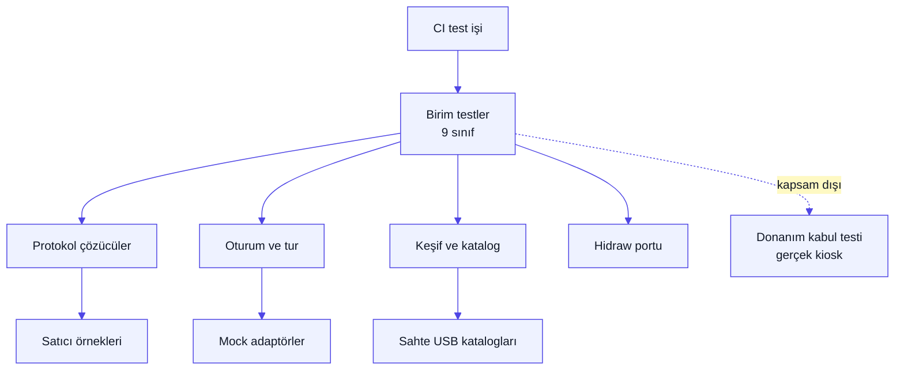

# Test Stratejisi ve Kapsamı

⬅ [Genel Mimari (Hub)](hub.md)

Proje kuralı (`CLAUDE.md`): protokol çerçeve çözücüleri donanımsız birim test edilir; harici G/Ç taklit edilir; UART/yazıcı yalnız donanımlı cihazda sınanır. `src/test/` altında **9 test sınıfı, yaklaşık 40 test** vardır; `androidTest` yoktur.

## Kapsam

| Test sınıfı | Ne sınar |
|-------------|----------|
| `VitalProtocolParserTest` | ASCII çözücüler: boy (noktalı/4 haneli, anormal ret), ateş, SpO2 (önizleme/kilitli/başarısız), tansiyon (şişirme ilerlemesi, manşet gevşek → Türkçe, kesik durum), kilo (kilitli, anlık, doluluk), `heightStart` komutu ([OEM ASCII](oem-ascii-protokolu.md)) |
| `EtcProtocolParserTest` | Dört USB cihazın çerçeveleri: HeTaiDa paketi, DYP TX + süzülmüş mesafe, BerryMed 5 baytlık paket, Raycome V1.3 (ölçüm, ACK ayrımı, hata, makul olmayan erken basınç, kontrol paketleri, cihaz bilgisi sorgusu) |
| `MeasurementSessionTest` | Mock turu ağırlıksız dört vital döndürür; tekil ölçüm; boy hatası turu durdurur; etkin olmayan modüller atlanır; boş etkin küme ölçmeden hata verir; sahte boy sabit cm |
| `HardwareDiscoveryServiceTest` | Mock yollarda seri modül keşfi; USB kataloğunda HeTaiDa; envanter anlık görüntüsü |
| `UsbDeviceCatalogTest` | VID/PID'nin uevent'ten bulunması, sysfs'in hub'ları atlaması, dosya sistemi katalogu, birleştirmede host girişinin önceliği, mock'a düşme |
| `UsbSensorRoleMapTest`, `AttachedEtcSensorsTest` | VID/PID → rol eşlemesi, bilinmeyen cihazda boş sonuç, yol belirteci gidiş-dönüşü |
| `HidrawInterruptPortTest` | HID rapor okuma ([HeTaiDa](hetaida-htd8808c-ates.md)) |
| `BodyMassIndexTest` | BMI hesabı; geçersiz girdide `null`; ayakta boy ofseti |

## Boşluklar

- **UI**: Compose ekranları ve `KioskViewModel` için test yok ([Kiosk Arayüz Akışı](kiosk-ui-akisi.md)).
- **Adaptörler**: gerçek `DypH01HeightAdapter`, `BerryMedSpo2Adapter`, `RaycomeBloodPressureAdapter` zamanlama/yeniden deneme mantığı için doğrudan test görünmüyor; yalnız çözücüleri testlidir ([Ölçüm Oturumu](olcum-oturumu.md)).
- **`runVitalTour`** testlidir ama ViewModel tarafından çağrılmaz, yani gerçek akışın bir kısmı testin sınadığı yoldan farklıdır.
- **Donanım**: USB izinleri, kök (`su`) erişim, Lztek kiosk API'leri, kilo/vücut/yazıcı ve gerçek zamanlama yalnız kiosk üzerinde doğrulanır ([Fizibilite Raporu](fizibilite-raporu.md)). `etc/*/android-log.txt` dosyaları ve `etc/*/python/*-test.png` ekran görüntüleri, bu cihazların masaüstü Python araçlarıyla bir kez sınandığına dair kanıttır.
- **Kimlik/HTTP/yazıcı**: kod olmadığından test de yok ([Faz 2](faz2-yazici-vucut-analizi-yukleme.md)).

## İlgili

- [Geliştirme Süreci](gelistirme-sureci.md)
- [Hexagonal Mimari](hexagonal-mimari.md)
