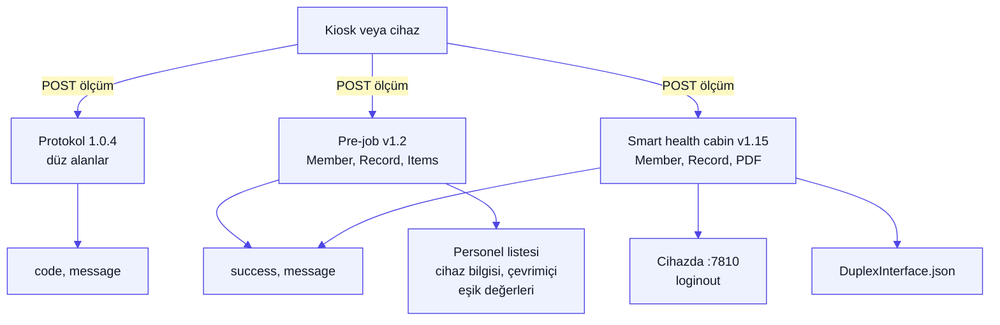

# Veri Yükleme Arayüzleri

⬅ [Genel Mimari (Hub)](hub.md)

Kaynak klasörde **üç ayrı HTTP sözleşmesi** vardır. Hangisinin hedef merkezle kullanılacağı kaynaklarda yazılı değildir; uygulamada henüz hiçbirinin istemcisi yoktur ([Faz 2](faz2-yazici-vucut-analizi-yukleme.md)). `interface protocol/` ve `Pre-job…docx` dosyaları sonradan eklenmiştir.

## Karşılaştırma

| Özellik | 1.0.4 (Mayıs 2024) | Pre-job v1.2 | Smart Health Cabin v1.15 |
|---------|--------------------|--------------|--------------------------|
| Yük biçimi | Düz alanlar (`height`, `weight`, `blood_oxygen`…) | `Member` + `Record[]` + `Items[]` | `Member` + `Record[]` + `ExamReportPdfFile` |
| Yanıt | `code` 1/0, `message` | `success`, `message` | `success`, `message` |
| Tarih biçimi | — | `yyyy-MM-dd` / `yyyy-MM-dd HH:mm:ss` | `MM-dd-yyyy` / `MM-dd-yyyy HH:mm:ss` |
| `DeviceType` | — | sabit `PREJOB` | `SPEIS` (örnek veride de `SPEIS`) |
| Yeniden deneme | Belirtilmemiş | 5 sn, 10 sn, 1 dk, 5 dk, sonra saatlik; 120 saat sonra veri atılır | Aynı kural |
| Kimlik doğrulama | — | Sayfa dosyasından üçüncü taraf parametreleri | HTTP Basic (`usercode:password` Base64) isteğe bağlı |
| Ek uç noktalar | Logo `GET` | Personel listesi, senkron kaydı, cihaz bilgisi, çevrimiçi, eşik | Cihaz tarafında `POST :7810/api/user/loginout` |

## Pre-job v1.2 ayrıntıları

- **Tek yönlü akış:** muayene bitince veriyi üçüncü tarafa gönderir (`POST HOST/endpoint`, örnek `v1/uploadbatch`).
- `Member`: `Sex` (1=erkek, 0=kadın), `Birthday`, `Name`, `Age`, `WorkNo`, `PatientId`, `IdCode`, `Photo` (alkol testi fotoğrafı; test yapılmadıysa yok), `HeadPhoto` (yüz tanıma girişi), ayrılmış alanlar. `ExamNo` oturum başına, `RecordNo` madde başına tekil.
- `Items`: `Code`, `Name`, `UNITS`, `RESULT`, `ABNORMAL_INDICATOR` (H/M/L), `DATERESULT`, `NORMAL_RANGE` (alt, üst; `null` olabilir).
- Birleşik proje kodları: 30 tansiyon (`SBP`, `DBP`), 40 kan oksijeni (`PulseRate`, `SpO2`), 50 vücut sıcaklığı (`Temp`), 400 alkol (`BAC`, `BrAC`; kodlar cihaza bağlı).
- Ek uç noktalar: `POST /api/Patient/PreworkList` (sayfa başı 10 kayıt, `hostid`, `page`, `uptime`; yanıtta ad, cinsiyet, kimlik no, doğum tarihi, bölüm, Base64 yüz, sicil, kart, `isvalid`), `POST api/consume/patient/updatePatStatus` (yalnız başarısız eşitlemeler `fail` olarak bildirilir; sonra başarılı olursa `success`), `GET /api/User/GetHostInfo`, `POST /api/user/addHostInfo`, `POST /api/user/UploadOnlineStatus` (dakikada bir; 3 dakika sessizlik = çevrimdışı) ve `GET /api/lis/GetLis_limittypeeditByHostgid` (ateş 34–37,3; nabız 40–100; SpO2 94–100; sistolik 90–140; diyastolik 60–90; alkol 0–20 varsayılan eşikler).

## Smart Health Cabin v1.15 ve örnek veri

- Cihaz `:7810` üzerinde dinler (`DuplexInterfaceLocalUrl`); `DuplexInterface.json` içinde yükleme adresi (`DuplexInterfaceUploadUrl`) ve `Batch` (muayene sonunda toplu) modu ayarlanır. Dosya program dizinine kendiliğinden paketlenmez; elle kopyalanır.
- `sample data.txt` (~1,2 MB, JSON) tek bir muayeneyi gösterir: `Member`, `UploadStatus`, `DeviceId`, `ExamNo`, `ExamDate`, Base64 `ExamReportPdfFile` ve kayıtlar. Kayıt kodları: 90 boy/BMI/kilo (`Height`, `BMI`, `WEIGHT`, `BMIResult`, ideal kilo), 30 tansiyon (`MAP`, `SBP`, `DBP`, `PulseRate`, `XYResult`), 330 merkezi arter basıncı (`CSBP`, `API`, `AVI`), 40 SpO2 (`SpO2`, `ListSpO2`, nabız listesi), 50 ateş (`Temp`), 180 vücut kompozisyonu (`BodyFatRatio`, `UVI`, `MuscleMass`, `PBW`), 490 ruhsal ölçek (kaygı, depresyon, uyku), 230 geleneksel Çin tıbbı beden tipi, 350 SCL-90 benzeri ölçek. Çoğu ölçüm için `…PA_*` (nüfus analizi) ve `…Result` (metin sonuç) maddeleri de gelir.

## Projeye etkisi

- Mevcut domain modeli (`MeasurementResult`, boy/ateş/SpO2/tansiyon) bu şemalara eşlenebilir: ateş→`Temp`, SpO2→`SpO2`/`PulseRate`, tansiyon→`SBP`/`DBP`/`PulseRate`, boy→`Height` ([Ölçüm Oturumu](olcum-oturumu.md)). Kilo ve BMI olmadan 90 kodlu kayıt eksik kalır.
- Yeniden deneme + çevrimdışı kuyruk gereksinimi üç sözleşmede de ortaktır; planlanan SQLite kuyruğu ancak bu kuralları (120 saat sonra at) uygularsa uyumlu olur.
- Sağlık, kimlik ve yüz verisi içerir; KVKK/özel nitelikli veri notları için [Fizibilite Raporu](fizibilite-raporu.md).
- Aynı ürün ailesine ait olan/olmayan cihaz bilgisi için: [INBCA Ürün Kataloğu](inbca-urun-katalogu.md).

## İlgili

- [Faz 2: Yazıcı, Vücut Analizi, Yükleme](faz2-yazici-vucut-analizi-yukleme.md)
- [Kiosk Arayüz Akışı](kiosk-ui-akisi.md)
